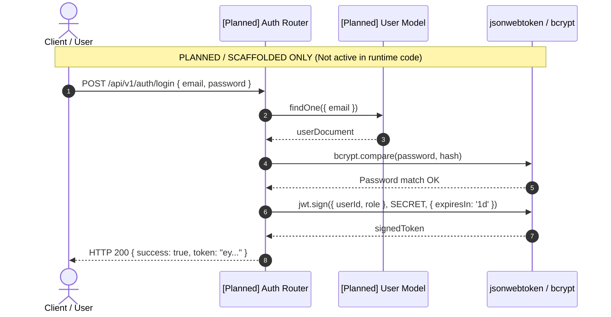
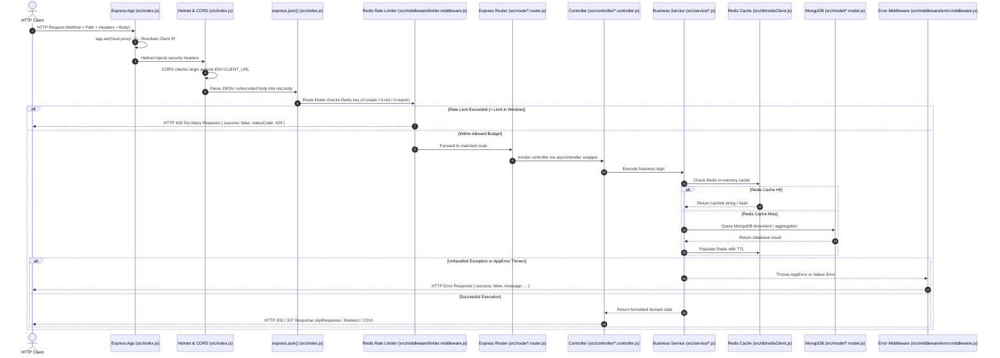

# API & Interface Specification: URL Shortener & Analytics System

**Document Version:** 1.0.0  
**Project Name:** `url_shortner`  
**System Type:** Backend RESTful Web Service  
**Target Audience:** Backend Engineers, API Consumers, Quality Assurance Engineers, Technical Interviewers, and Integration Partners  
**Companion Documents:**  
* Document 1: `docs/project_requirement_description.md` (PRD)  
* Document 2: `docs/architecture_overview.md` (Architecture Overview)  
* Document 3: `docs/tech_stack_and_dependencies.md` (Tech Stack & Dependencies)  
* Document 4: `docs/data_model_and_database_schema.md` (Data Model & Database Schema)

---

## 1. API Summary

### Plain-Language Summary
This system exposes a lean, high-throughput RESTful HTTP API designed to create short URLs, execute sub-10ms redirects, and provide click telemetry and analytics. It provides 7 endpoints across three distinct route prefixes: `/api/v1/url` for link creation and listing, `/` for public redirection lookups, and `/api/v1/analysis` for global analytics dashboards, single-link metrics, hourly/daily trends, and CSV report downloads. All JSON endpoints follow standardized response payloads, while redirection uses HTTP 307 temporary redirects and reports stream raw CSV text.

### 30-Second Spoken Pitch (API Edition)
> "The API is a RESTful microservice built with Express 5 that exposes 7 endpoints across URL management, redirection, and telemetry. It has zero authentication gates today, operating as a public utility protected by Redis rate limiting across three tiers: link creation (50 req/min), redirection and analytics (100 req/min), and CSV generation (5 req/15min). Redirects respond with HTTP 307 headers directly from a Redis cache, JSON endpoints return uniform ApiResponse structures, and all operational failures bubble up to a centralized error interceptor returning consistent JSON error envelopes."

### The "Restaurant Menu & Waiter" Analogy
Think of this API like an **express drive-through restaurant**:
* **The Menu Board (API Route Table):** A clear board listing 7 items you can order—ordering a custom short box (`POST /api/v1/url`), ordering the express meal (`GET /:shortCode`), or asking for the manager's receipt log (`GET /api/v1/analysis/*`).
* **The Bouncer at the Speaker (`limiter.middleware.js`):** A guard at the microphone who counts how many times you order per minute. If you shout orders more than 50 or 100 times in 60 seconds, they mute your microphone and play a recorded warning (HTTP 429 Too Many Requests).
* **The Standard Serving Tray (`ApiResponse`):** Every hot meal is served on the exact same plastic tray with three compartments: status code, message, and the food item (`data`).
* **The Spill Kit (`errorMiddleware`):** If a cook drops a plate in the kitchen, the dining room never sees the mess—the spill kit wraps the incident into a polite printed apology note (`{ success: false, message: ... }`).

### API Style, Base URLs, and Router Mounting
* **API Style:** REST (Representational State Transfer) with resource-oriented URLs and HTTP status verbs.
* **Base URL Pattern:** `/api/v1/*` for administrative, creation, and analytical endpoints; root `/` for public redirection.
* **Route Registration File:** `src/index.js` (lines 28–30):
  * `app.use('/api/v1/url', urlRouter)` (`src/route/url.router.js`)
  * `app.use('/', redirectionRouter)` (`src/route/redirection.router.js`)
  * `app.use('/api/v1/analysis', analysisRouter)` (`src/route/analysis.router.js`)

---

## 2. General Conventions

### Data Formats & Protocols
* **Request Payloads:** `application/json` parsed via `express.json()` in `src/index.js` (line 23). Also supports URL-encoded form bodies via `express.urlencoded({ extended: true })`.
* **Standard Response Payload:** `application/json` wrapped in the `ApiResponse` class (`src/util/ApiResponse.js`).
* **File Export Response Payload:** `text/csv` with `Content-Disposition: attachment` header (`src/controller/analysis.controller.js`, line 42).
* **Redirection Response Payload:** Empty body with HTTP status `307 Temporary Redirect` and a `Location` header (`src/controller/url.controller.js`, line 18).

### Structural Conventions
* **Case Conventions:**
  * **JSON Request & Response Keys:** `camelCase` (e.g., `orgURL`, `shortCode`, `expiresAt`, `clickCount`, `lastClickedAt`).
  * **Database Entity & Collection Names:** Singular/PascalCase in Mongoose definitions (`shortURL`, `Analytics`, `Counter`, `Email`) and lowercase/plural in MongoDB storage.
  * **Redis Key Names:** Namespaced with colon prefixes (e.g., `url:<shortCode>`, `map:<shortCode>`, `stats:<id>`, `trend:<id>`, `rl-red:<ip>`).
* **Date and Time Format:** ISO-8601 strings in UTC (e.g., `2024-12-31T23:59:59.000Z`) for storage and API responses.
* **ID Format:** 24-character hexadecimal MongoDB ObjectIds (e.g., `65f1a2b3c4d5e6f7a8b9c0d1`).

### Environment Base URLs
* **Development:** `http://localhost:5000` (Loaded via `ENV.BASE_URL` in `src/util/env.js`).
* **Production:** Configured via environment variable `BASE_URL` (e.g., `https://short.domain.com/`).
* **Client Origin (CORS):** Bound to `ENV.CLIENT_URL` (default: `http://localhost:3000`).

---

## 3. Authentication and Authorization

### Current Authentication Status
* **Status in Code:** **Completely Unauthenticated / Public API.**
* **Explanation:**
  * No authorization headers (`Authorization: Bearer <token>`) are inspected by any active route.
  * No cookie-based sessions or authentication tokens are verified in `src/route/*.router.js`.
  * Anyone who has network access to the API can generate short URLs, view global analytics, query single link statistics, and download CSV telemetry exports.

### Scaffolded Authentication Traces in Codebase
While active endpoints are public, authentication was planned during initial development:
1. **Unused Dependencies in `package.json`:** `bcrypt` (^6.0.0), `jsonwebtoken` (^9.0.3), and `cookie-parser` (^1.4.7) are installed.
2. **Scaffolded Model Reference:** `src/model/url.model.js` (line 15) contains `generatedBy: { type: Schema.Types.ObjectId, ref: 'User', index: true }`, but no `User` model exists.
3. **Commented-Out Validation Schemas in `src/util/validation.js` (lines 6–51):** Complete Zod validation schemas for `validFullName`, `validEmail`, `validContactNo`, and `validPassword` exist as commented code.

### Intended Authentication Sequence (Scaffolded Design)
The Mermaid diagram below illustrates how authentication was intended to operate based on installed dependencies and commented validation rules:



---

## 4. Request Lifecycle

The diagram below outlines the exact sequence through which an incoming HTTP request travels through Express middleware, routers, controllers, services, database engines, and error interceptors.



### Request Lifecycle Step Breakdown
1. **IP Resolution:** `app.set('trust proxy', 1)` in `src/index.js` extracts the client IP from the `X-Forwarded-For` header.
2. **Security Headers:** `helmet()` adds defensive HTTP headers (CSP, anti-clickjacking, frameguard).
3. **CORS Enforcement:** `cors(corsOptions)` verifies the `Origin` header matches `ENV.CLIENT_URL`.
4. **Body Parsing:** `express.json()` and `express.urlencoded({ extended: true })` parse the payload into `req.body`.
5. **Rate Limiting:** Endpoint-level limiters (`createLimiter`, `redirectLimiter`, `reportLimiter`) check and increment client IP counters in Redis.
6. **Route Dispatch:** Express evaluates route paths and parameters.
7. **Controller Handling:** Controller executes within `asyncHandler` (`src/util/asyncHandler.js`), catching unhandled promise rejections.
8. **Service Execution:** Business logic executes validations, Redis lookups, Base62 conversions, and MongoDB queries.
9. **Response Formulation:** Returns formatted `ApiResponse` JSON, raw CSV streams, or HTTP 307 temporary redirects.
10. **Error Interception:** If an exception occurs, `errorMiddleware` in `src/middleware/error.middleware.js` formats the error and responds with an appropriate HTTP status.

---

## 5. Endpoint Overview Table

| Method | Endpoint Path | Purpose in Simple Words | Auth Required | Feature ID | Handler File & Function |
| :--- | :--- | :--- | :--- | :--- | :--- |
| **`POST`** | `/api/v1/url/` | Creates a short link from an original long URL. | None (Public) | F-1, F-2 | `src/controller/url.controller.js` $\rightarrow$ `shortURLGenerator` |
| **`GET`** | `/api/v1/url/` | Lists all active short URLs sorted newest to oldest. | None (Public) | F-10 | `src/controller/urlList.controller.js` $\rightarrow$ `getAllURLs` |
| **`GET`** | `/:shortCode` | Redirects visitor to the original destination URL via HTTP 307. | None (Public) | F-3, F-4 | `src/controller/url.controller.js` $\rightarrow$ `urlRedirection` |
| **`GET`** | `/api/v1/analysis/` | Global analytics dashboard aggregated across all active links. | None (Public) | F-5 | `src/controller/analysis.controller.js` $\rightarrow$ `getAllDetails` |
| **`GET`** | `/api/v1/analysis/:shortCode` | Analytics metric breakdown for a single short code. | None (Public) | F-6 | `src/controller/analysis.controller.js` $\rightarrow$ `getParticualShortCodeDetail` |
| **`GET`** | `/api/v1/analysis/:shortCode/trend` | Hourly (IST) and daily click trends for a short code. | None (Public) | F-7 | `src/controller/analysis.controller.js` $\rightarrow$ `getURLAnalyticsTrend` |
| **`GET`** | `/api/v1/analysis/:shortCode/generateReport` | Generates and downloads a CSV spreadsheet of raw click logs. | None (Public) | F-8 | `src/controller/analysis.controller.js` $\rightarrow$ `getReport` |

---

## 6. Detailed Endpoint Reference

---

### Endpoint 1: Create Short URL
* **Method & Path:** `POST /api/v1/url/`
* **Purpose:** Accepts an original long web address, validates it, generates an atomic Base62 code, and persists the link with an expiration date.
* **Feature ID:** F-1, F-2
* **Authentication & Role:** None (Public)
* **Rate Limit:** 50 requests per 1 minute per IP (`createLimiter`, prefix `rl-create:`).

#### Request Parameters & Body
* **Headers:** `Content-Type: application/json`
* **Path / Query Parameters:** None.
* **Request Body Fields:**

| Field Name | Type | Required / Optional | Validation Rules | Description |
| :--- | :--- | :--- | :--- | :--- |
| `orgURL` | String | **Required** | Must be a valid web URL syntax; cannot contain consecutive dots (`..`); must have a valid domain or localhost. Auto-prepends `https://` if protocol is omitted. | The original long web address to be shortened. |
| `expiresAt`| String (ISO Date) | Optional | Valid ISO-8601 date string. Defaults to `now + 30 days` if omitted. | The date and time when the link should expire and be deleted. |

#### Example Request
```http
POST /api/v1/url/ HTTP/1.1
Host: localhost:5000
Content-Type: application/json

{
  "orgURL": "https://developer.mozilla.org/en-US/docs/Web/HTTP/Status/307",
  "expiresAt": "2025-12-31T23:59:59.000Z"
}
```

#### Example Success Response
* **HTTP Status Code:** `200 OK`
```json
{
  "statusCode": 200,
  "message": "Short URL Generated Successfully.",
  "data": "http://localhost:5000/17K1jt",
  "success": true
}
```

#### Possible Error Responses
* **`400 Bad Request`:** Thrown by `validateURL` in `src/util/validation.js` when `orgURL` is malformed, lacks a domain, or contains double dots (`..`).
  ```json
  {
    "success": false,
    "message": "Invalid URL"
  }
  ```
* **`429 Too Many Requests`:** Thrown when exceeding 50 requests in 1 minute.
  ```json
  {
    "success": false,
    "statusCode": 429,
    "message": "Too many requests, please try again later."
  }
  ```
* **`500 Internal Server Error`:** Database connection loss or atomic counter increment failure.
  ```json
  {
    "success": false,
    "message": "Internal Server Error"
  }
  ```

#### Internal Processing Steps & Side Effects
1. `validateURL(orgURL)` standardizes the URL and cleans search/hash parameters.
2. Atomically increments counter in MongoDB: `Counter.findOneAndUpdate({ id: 'urlCounter' }, { $inc: { counter: 1 } }, { new: true, upsert: true })`.
3. Encodes counter integer into Base62 string using `encodeBase62()`.
4. Writes document to MongoDB `shortURL` collection.
5. Returns full short URL concatenated with `ENV.BASE_URL`.
* **Side Effects:** Writes 1 document to `counters` (increment) and 1 document to `shorturls`.

---

### Endpoint 2: List All Active URLs
* **Method & Path:** `GET /api/v1/url/`
* **Purpose:** Retrieves a list of all active shortened URLs, including click counts and timestamps, sorted newest first.
* **Feature ID:** F-10
* **Authentication & Role:** None (Public)
* **Rate Limit:** 100 requests per 1 minute per IP (`redirectLimiter`, prefix `rl-red:`).

#### Request Parameters & Body
* **Headers:** `Accept: application/json`
* **Path / Query / Body:** None.

#### Example Request
```http
GET /api/v1/url/ HTTP/1.1
Host: localhost:5000
Accept: application/json
```

#### Example Success Response
* **HTTP Status Code:** `200 OK`
```json
{
  "statusCode": 200,
  "message": "URLs fetched successfully",
  "data": [
    {
      "_id": "65f1a2b3c4d5e6f7a8b9c0d1",
      "originalUrl": "https://example.com/docs",
      "shortCode": "17K1jt",
      "shortUrl": "http://localhost:5000/17K1jt",
      "clickCount": 12,
      "createdAt": "2024-05-20T10:00:00.000Z",
      "lastClickedAt": null
    }
  ],
  "success": true
}
```

#### Possible Error Responses
* **`429 Too Many Requests`:** Rate limit exceeded.
* **`500 Internal Server Error`:** Throws `AppError("Failed to fetch URLs", 500)` if database query fails.

#### Architectural Anomaly Note
* **File:** `src/controller/urlList.controller.js` (lines 8–18)
* **Anomaly:** This controller directly queries `shortURL.find({ isActive: true })`, bypassing the service layer entirely. It projects `lastClickedAt`, which is not defined in `src/model/url.model.js` and always returns `null`.

---

### Endpoint 3: Redirect Short URL
* **Method & Path:** `GET /:shortCode`
* **Purpose:** Looks up the short code, executes an HTTP 307 temporary redirect to the destination, and asynchronously logs click telemetry.
* **Feature ID:** F-3, F-4
* **Authentication & Role:** None (Public)
* **Rate Limit:** 100 requests per 1 minute per IP (`redirectLimiter`, prefix `rl-red:`).

#### Request Parameters & Body
* **Path Parameters:**

| Parameter | Type | Required | Validation Rules | Description |
| :--- | :--- | :--- | :--- | :--- |
| `shortCode` | String | **Required** | Minimum length 4 characters; alphanumeric regex only (`/^[a-zA-Z0-9]+$/`). | The Base62 short code to look up. |

* **Headers Read by System:** `User-Agent`, `Referer`, `X-Forwarded-For`.

#### Example Request
```http
GET /17K1jt HTTP/1.1
Host: localhost:5000
User-Agent: Mozilla/5.0 (Windows NT 10.0; Win64; x64) AppleWebKit/537.36 Chrome/120.0.0.0 Safari/537.36
Referer: https://t.co/
```

#### Example Success Response
* **HTTP Status Code:** `307 Temporary Redirect`
* **Response Headers:** `Location: https://developer.mozilla.org/en-US/docs/Web/HTTP/Status/307`
* **Response Body:** Empty body / browser redirection.

#### Possible Error Responses
* **`404 Not Found`:** Short code does not exist in Redis or MongoDB, is marked `isActive: false`, or has expired (`expiresAt < now`).
  ```json
  {
    "success": false,
    "message": "URL not exist or expired"
  }
  ```
* **`406 Not Acceptable`:** Thrown by `validShortCode` if code is under 4 characters or contains special characters.
  ```json
  {
    "success": false,
    "message": "Invalid Short URL"
  }
  ```
* **`429 Too Many Requests`:** Rate limit exceeded.

#### Internal Processing Steps & Side Effects
1. Validates code format with `validShortCode(shortCode)`.
2. Checks Redis cache `url:<shortCode>`. On cache miss, queries MongoDB `shortURL.findOne`, computes dynamic TTL (`Math.min(remainingTime, 3600)`), and populates Redis cache.
3. Fires unawaited background promise `captureAnalytics(id, metadata)`.
4. Issues `res.redirect(307, destinationURL)`.
5. Background task increments `shortURL.click` by 1 and writes a document to MongoDB `Analytics` collection with IP, geolocation (`geoip-lite`), and device data (`ua-parser-js`).
* **Side Effects:** Redis cache key created/accessed; MongoDB `click` incremented; new record inserted into `analytics`.

---

### Endpoint 4: Global Analytics Dashboard
* **Method & Path:** `GET /api/v1/analysis/`
* **Purpose:** Returns comprehensive click telemetry aggregated across all active links in the database.
* **Feature ID:** F-5
* **Authentication & Role:** None (Public)
* **Rate Limit:** 100 requests per 1 minute per IP (`redirectLimiter`, prefix `rl-red:`).

#### Request Parameters & Body
* **Headers:** `Accept: application/json`
* **Path / Query / Body:** None.

#### Example Request
```http
GET /api/v1/analysis/ HTTP/1.1
Host: localhost:5000
Accept: application/json
```

#### Example Success Response
* **HTTP Status Code:** `200 OK`
```json
{
  "statusCode": 200,
  "message": "Everything is working",
  "data": {
    "categorizedByRegion": [{ "_id": "DL", "total": 14 }, { "_id": "CA", "total": 8 }],
    "categorizedByCountry": [{ "_id": "IN", "total": 25 }, { "_id": "US", "total": 12 }],
    "categorizedByCity": [{ "_id": "Delhi", "total": 14 }, { "_id": "San Francisco", "total": 8 }],
    "categorizedByReferrer": [{ "_id": "Direct", "total": 20 }, { "_id": "https://t.co/", "total": 17 }],
    "categorizedByDevice": [{ "_id": "Desktop", "total": 22 }, { "_id": "Mobile", "total": 15 }],
    "categorizedByBrowser": [{ "_id": "Chrome", "total": 28 }, { "_id": "Safari", "total": 9 }],
    "categorizedByOS": [{ "_id": "Windows", "total": 18 }, { "_id": "iOS", "total": 10 }],
    "countClickOnEachLink": [
      { "_id": "65f1a2b3c4d5e6f7a8b9c0d1", "total": 25 },
      { "_id": "65f1a2b3c4d5e6f7a8b9c0d2", "total": 12 }
    ]
  },
  "success": true
}
```

#### Possible Error Responses
* **`429 Too Many Requests`:** Rate limit exceeded.
* **`500 Internal Server Error`:** Aggregation pipeline failure.

#### Architectural Performance Note
* This endpoint is **not cached in Redis**. Every request runs a MongoDB `$lookup` joining the entire `shorturls` collection with `analytics` followed by an `$unwind` and 8-way `$facet` aggregation. Under high load, this query can cause CPU spikes.

---

### Endpoint 5: Single-URL Analytics Breakdown
* **Method & Path:** `GET /api/v1/analysis/:shortCode`
* **Purpose:** Returns aggregated click analytics specifically for a single short code, utilizing a two-tier Redis cache.
* **Feature ID:** F-6
* **Authentication & Role:** None (Public)
* **Rate Limit:** 100 requests per 1 minute per IP (`redirectLimiter`, prefix `rl-red:`).

#### Request Parameters & Body
* **Path Parameters:**

| Parameter | Type | Required | Validation Rules | Description |
| :--- | :--- | :--- | :--- | :--- |
| `shortCode` | String | **Required** | Minimum length 4 characters; alphanumeric regex (`/^[a-zA-Z0-9]+$/`). | The short code whose analytics to retrieve. |

#### Example Request
```http
GET /api/v1/analysis/17K1jt HTTP/1.1
Host: localhost:5000
Accept: application/json
```

#### Example Success Response
* **HTTP Status Code:** `200 OK`
```json
{
  "statusCode": 200,
  "message": "Everything is working",
  "data": {
    "categorizedByRegion": [{ "_id": "DL", "total": 5 }],
    "categorizedByCountry": [{ "_id": "IN", "total": 5 }],
    "categorizedByCity": [{ "_id": "Delhi", "total": 5 }],
    "categorizedByReferrer": [{ "_id": "Direct", "total": 5 }],
    "categorizedByDevice": [{ "_id": "Desktop", "total": 5 }],
    "categorizedByBrowser": [{ "_id": "Chrome", "total": 5 }],
    "categorizedByOS": [{ "_id": "Windows", "total": 5 }],
    "countClickOnEachLink": [{ "_id": "65f1a2b3c4d5e6f7a8b9c0d1", "total": 5 }]
  },
  "success": true
}
```

#### Possible Error Responses
* **`404 Not Found`:** Short code does not exist in MongoDB.
  ```json
  {
    "success": false,
    "message": "Invalid URL"
  }
  ```
* **`406 Not Acceptable`:** Code validation failed.
* **`429 Too Many Requests`:** Rate limit exceeded.

#### Internal Processing Steps & Caching Mechanics
1. Validates `shortCode`.
2. Checks Redis string `map:<shortCode>`. If found, checks Redis hash `stats:<id>` via `redis.hgetall()`.
3. If cached, parses JSON fields and returns immediately without database access.
4. On cache miss: Queries MongoDB `shortURL` for ID, stores `map:<shortCode>` with 1-hour TTL, executes MongoDB aggregation on `Analytics`, and populates Redis hash `stats:<id>` with a 300-second (5-minute) TTL.

---

### Endpoint 6: Hourly and Daily Click Trends
* **Method & Path:** `GET /api/v1/analysis/:shortCode/trend`
* **Purpose:** Returns click volume grouped by hour of the day (in IST `+05:30`) and calendar date for a specific link.
* **Feature ID:** F-7
* **Authentication & Role:** None (Public)
* **Rate Limit:** 100 requests per 1 minute per IP (`redirectLimiter`, prefix `rl-red:`).

#### Request Parameters & Body
* **Path Parameters:** `shortCode` (String, required, min length 4, alphanumeric).

#### Example Request
```http
GET /api/v1/analysis/17K1jt/trend HTTP/1.1
Host: localhost:5000
Accept: application/json
```

#### Example Success Response
* **HTTP Status Code:** `200 OK`
```json
{
  "statusCode": 200,
  "message": "Everything is working",
  "data": {
    "perHourClick": [
      { "_id": 14, "totalClick": 3 },
      { "_id": 15, "totalClick": 7 }
    ],
    "perDayClick": [
      { "_id": "2024-05-19", "totalClick": 4 },
      { "_id": "2024-05-20", "totalClick": 6 }
    ]
  },
  "success": true
}
```

#### Possible Error Responses
* **`404 Not Found`:** Short code does not exist. Returns `{ "success": false, "message": "Short Code not Found" }`.
* **`406 Not Acceptable`:** Invalid short code format.
* **`429 Too Many Requests`:** Rate limit exceeded.

#### Internal Processing Steps
* Utilizes two-tier Redis caching with keys `trend:<shortCode>` (ID map, TTL 1 hour) and `trend:<id>` (hash data, TTL 300s).
* MongoDB aggregation groups `$hour` and `$dateToString` using timezone `+05:30`.

---

### Endpoint 7: Generate and Export CSV Analytics Report
* **Method & Path:** `GET /api/v1/analysis/:shortCode/generateReport`
* **Purpose:** Streams a downloadable CSV spreadsheet containing all raw click event logs for a specific short link.
* **Feature ID:** F-8
* **Authentication & Role:** None (Public)
* **Rate Limit:** **Strict: 5 requests per 15 minutes per IP** (`reportLimiter`, prefix `rl-report:`).

#### Request Parameters & Body
* **Path Parameters:** `shortCode` (String, required, min length 4, alphanumeric).

#### Example Request
```http
GET /api/v1/analysis/17K1jt/generateReport HTTP/1.1
Host: localhost:5000
```

#### Example Success Response
* **HTTP Status Code:** `200 OK`
* **Response Headers:**
  * `Content-Type: text/csv; charset=utf-8`
  * `Content-Disposition: attachment; filename=report-17K1jt.csv`
* **Raw CSV Response Body:**
```csv
"ip","city","country","region","device","browser","os","referrer","clickDate"
"47.15.230.222","Delhi","IN","DL","Desktop","Chrome","Windows","Direct","2024-05-20T14:32:10.000Z"
"122.161.45.12","Mumbai","IN","MH","Mobile","Safari","iOS","https://t.co/","2024-05-20T14:45:00.000Z"
```

#### Possible Error Responses
* **`404 Not Found`:** Link not found or no click logs recorded yet. Returns `{ "success": false, "message": "No analytics data found" }` or `{ "success": false, "message": "No URL Found" }`.
* **`429 Too Many Requests`:** Rate limit exceeded (more than 5 requests in 15 minutes).
  ```json
  {
    "success": false,
    "statusCode": 429,
    "message": "Too many requests, please try again later."
  }
  ```

---

## 7. Error Handling

### Standard JSON Error Format
All application errors bubble up to `src/middleware/error.middleware.js` and return a uniform JSON envelope:

```json
{
  "success": false,
  "message": "Error description message"
}
```

*(Note: Rate limiter errors injected by `express-rate-limit` also include an explicit `"statusCode": 429` field inside the envelope).*

### System Error Catalog

| Error Type / Message | HTTP Status | Meaning | Source Location | Client Action |
| :--- | :--- | :--- | :--- | :--- |
| `"Invalid URL"` | `400 Bad Request` | Provided `orgURL` is malformed, lacks domain, or has syntax errors. | `src/util/validation.js` | Fix URL syntax and re-submit. |
| `"URL not exist or expired"` | `404 Not Found` | Short code does not exist, has expired, or is marked inactive. | `src/service/urlService.js` | Check code spelling or generate a new link. |
| `"Invalid URL"` / `"Short Code not Found"` | `404 Not Found` | Short code does not exist in analytics database. | `src/service/analyticService.js` | Verify the short code exists. |
| `"No analytics data found"` | `404 Not Found` | Short link exists but has zero click logs to export. | `src/service/analyticService.js` | Wait for links to receive clicks before exporting. |
| `"Invalid Short URL"` | `406 Not Acceptable` | Short code is $< 4$ characters or contains special characters. | `src/util/validation.js` | Send valid alphanumeric code $\ge 4$ characters. |
| `"Too many requests, please try again later."` | `429 Too Many Requests`| Client exceeded rate limit window threshold. | `src/middleware/limiter.middleware.js` | Back off and wait for the rate-limiting window to reset. |
| `"Internal Server Error"` | `500 Server Error` | Database connection lost, aggregation failure, or unexpected crash. | `src/middleware/error.middleware.js` | Retry request or contact system administrator. |

---

## 8. Validation and Data Contracts

### Validation Libraries & Strategy
* **Primary Validation Engine:** **Zod (`^4.3.6`)** and native JavaScript constructor validation (`new URL()`) inside `src/util/validation.js`.
* **Validation Points:**
  * **Short Code Contract (`validShortCode`):** Enforces minimum length 4 and regex `/^[a-zA-Z0-9]+$/`.
  * **URL Syntax Contract (`validateURL`):** Rejects double dots (`..`), enforces protocol prefixes, and parses origin/pathname/search.
  * **ObjectId Contract (`validMongooseId`):** Checks `mongoose.isValidObjectId(id)`.

### Shared Data Contracts & Transfer Classes

#### 1. `ApiResponse` (`src/util/ApiResponse.js`)
Standard class used by controllers to wrap all JSON success responses:
```javascript
export class ApiResponse {
  constructor(statusCode, message = '', data = null, success = true) {
    this.message = message
    this.statusCode = statusCode
    this.success = success
    this.data = data
  }
}
```

#### 2. `AppError` (`src/util/ApiError.js`)
Standard operational error class:
```javascript
export class AppError extends Error {
  constructor(message, statusCode = StatusCodes.INTERNAL_SERVER_ERROR, isOperational = true, success = false) {
    super(message)
    this.statusCode = statusCode
    this.isOperational = isOperational
    this.name = this.constructor.name
    this.success = success
    Error.captureStackTrace(this, this.constructor)
  }
}
```

---

## 9. Pagination, Filtering, Sorting, and Search

* **Pagination Support:** **None found.**
  * The active link catalog endpoint (`GET /api/v1/url/`) retrieves all active documents using `shortURL.find({ isActive: true })` without `skip()` or `limit()` parameters.
  * The CSV export endpoint (`GET /api/v1/analysis/:shortCode/generateReport`) streams all matching documents in memory without pagination.
* **Sorting Support:**
  * `GET /api/v1/url/`: Hardcoded sort by creation date descending: `.sort({ createdAt: -1 })`.
  * `GET /api/v1/analysis/`: Hardcoded sort on top-clicked links descending: `{ $sort: { total: -1 } }`.
* **Filtering and Search:**
  * No search query parameters (e.g., `?search=google` or `?dateFrom=2024-01-01`) are implemented on any endpoint.

---

## 10. Rate Limiting, CORS, and Security Controls

### Rate Limiting Configuration Table

| Limiter Name | Rate Window | Max Requests | Redis Key Prefix | Applied Endpoints | Defined In File |
| :--- | :--- | :--- | :--- | :--- | :--- |
| `createLimiter` | 1 Minute (`60,000ms`) | 50 | `rl-create:` | `POST /api/v1/url/` | `src/middleware/limiter.middleware.js` |
| `redirectLimiter`| 1 Minute (`60,000ms`) | 100 | `rl-red:` | `GET /:shortCode`, `GET /api/v1/url/`, `GET /api/v1/analysis/*` | `src/middleware/limiter.middleware.js` |
| `reportLimiter` | 15 Minutes (`900,000ms`)| 5 | `rl-report:` | `GET /api/v1/analysis/:shortCode/generateReport` | `src/middleware/limiter.middleware.js` |

### Security Headers & CORS
* **Helmet (`helmet()` in `src/index.js`):** Injects standard HTTP protection headers.
* **CORS Settings (`src/index.js`):**
  * `origin: ENV.CLIENT_URL`
  * `credentials: true`
  * `methods: ['GET', 'POST', 'PUT', 'DELETE']`
  * `allowedHeaders: ['Content-Type', 'Authorization']`
* **Proxy Safety:** `app.set('trust proxy', 1)` enables accurate client IP resolution behind reverse proxies (e.g., Nginx, AWS ALB, Cloudflare).

---

## 11. File Uploads and Downloads

* **File Uploads:** **None found.** The API accepts JSON and URL-encoded text bodies only. No file upload middleware (like `multer` or `busboy`) exists in the project.
* **File Downloads:**
  * **Endpoint:** `GET /api/v1/analysis/:shortCode/generateReport`
  * **File Format:** CSV (`text/csv`).
  * **Generation Method:** Generated on-the-fly in memory using `@json2csv/plainjs`'s `Parser`.
  * **Attachment Name:** Dynamically set to `report-<shortCode>.csv`.
  * **Limits:** Controlled by strict rate limiting (5 downloads per 15 minutes per IP).

---

## 12. Realtime, Webhooks, and Async Interfaces

* **WebSockets / Server-Sent Events (SSE):** **None found.**
* **Incoming / Outgoing Webhooks:** **None found.**
* **Asynchronous Telemetry Interface:**
  * **Mechanism:** In-process unawaited promise execution (`captureAnalytics`).
  * **Location:** `src/service/urlService.js` (lines 106–108).
  * **Behavior:** When an HTTP redirect is triggered, the telemetry promise runs in the background of the Node.js event loop without blocking the HTTP 307 response.

---

## 13. External APIs Consumed

* **External Network APIs Consumed:** **None.**
* **Embedded Intelligence Engines:**
  * **`geoip-lite`:** Queries a local, offline MaxMind binary database bundled inside `node_modules` (`src/service/urlService.js`). It executes entirely in-memory with zero network overhead.
  * **`ua-parser-js`:** Uses local regular expression parsing to classify device, OS, and browser types from the incoming `User-Agent` string.

---

## 14. Internal Interfaces

### Internal Service Layer Contracts

#### 1. `shortURLGeneratorService(data)` (`src/service/urlService.js`)
* **Input:** `{ orgURL: string, expiresAt?: string | Date }`
* **Output:** `Promise<string>` (Full shortened URL string, e.g., `"http://localhost:5000/17K1jt"`).
* **Throws:** `AppError(400)` on invalid URL, `AppError(500)` on database failure.

#### 2. `urlRedirectionService(shortCode, req)` (`src/service/urlService.js`)
* **Input:** `shortCode` (string), `req` (Express Request object containing `ip`, `headers`).
* **Output:** `Promise<string>` (Original destination URL string).
* **Throws:** `AppError(404)` on missing/expired URL, `AppError(406)` on malformed code.

#### 3. `captureAnalytics(orgUrlId, analyticsData)` (`src/service/urlService.js`)
* **Input:** `orgUrlId` (Mongoose ObjectId / string), `analyticsData: { ip: string, userAgent: string, referrer: string }`.
* **Output:** `Promise<void>`.
* **Behavior:** Asynchronously increments click counter and writes a document to `Analytics` collection.

#### 4. `exportAnalyticsCSV(shortCode)` (`src/service/analyticService.js`)
* **Input:** `shortCode` (string).
* **Output:** `Promise<string>` (Raw CSV string text).
* **Throws:** `AppError(404)` if link or telemetry records do not exist.

---

## 15. Client Usage Map

* **Frontend Status:** No frontend client lives in this repository.
* **External Client Compatibility:** Any web application (e.g., React, Vue, Next.js) or mobile app operating at `ENV.CLIENT_URL` can interact with all 7 endpoints.
* **Orphaned / Uncalled Endpoints:** None; all 7 endpoints have corresponding automated integration tests in `tests/integration/` and load testing scripts in `load/`.

---

## 16. Feature to Endpoint Coverage

| Feature ID | Feature Name | Mapped HTTP Endpoint |
| :--- | :--- | :--- |
| **F-1** | Atomic Base62 Short URL Generation | `POST /api/v1/url/` |
| **F-2** | Configurable URL Expiration (TTL) | `POST /api/v1/url/` |
| **F-3** | Sub-10ms Cached Redirection | `GET /:shortCode` |
| **F-4** | Non-Blocking Click Telemetry Capture | `GET /:shortCode` (Background dispatch) |
| **F-5** | Global Multi-Faceted Analytics Dashboard | `GET /api/v1/analysis/` |
| **F-6** | Single-Code Cached Analytics Breakdown | `GET /api/v1/analysis/:shortCode` |
| **F-7** | Hourly and Daily Trend Telemetry | `GET /api/v1/analysis/:shortCode/trend` |
| **F-8** | CSV Analytics Report Export | `GET /api/v1/analysis/:shortCode/generateReport` |
| **F-9** | Multi-Tier Redis Rate Limiting | Applied across all 7 endpoints via middleware |
| **F-10** | Active URL Listing | `GET /api/v1/url/` |
| **F-11** | Email Dispatch System | **No Endpoint** (Scaffolded model and libraries only) |
| **F-12** | User Management & Auth | **No Endpoint** (Commented validation schemas only) |

---

## 17. API Testing

### Test Suite Inventory
* **Integration Tests:** Located in `tests/integration/`:
  * `tests/integration/url.test.js`: Validates `POST /api/v1/url/`, `GET /:shortCode` caching, 307 redirects, TTL expirations, and database fallbacks.
  * `tests/integration/analytic.test.js`: Validates `GET /api/v1/analysis/`, `GET /api/v1/analysis/:shortCode`, trend queries, and CSV generation.
* **Unit Tests:** Located in `tests/unit/`:
  * Validates Base62 encoding (`hashGenerator.test.js`), input validation (`validation.test.js`), and individual service methods.
* **Load Test Scripts (k6):** Located in `load/`:
  * `load/createShortURL.test.js`, `load/redirect.test.js`, `load/analytics.test.js`.

### Commands to Run Tests
```bash
# Run all unit and integration tests with coverage
npm test

# Run a specific test suite
npx jest tests/integration/url.test.js
```

### End-to-End cURL Verification Sequence
Execute the following commands sequentially against a running local instance (`http://localhost:5000`):

```bash
# 1. Create a short URL
curl -X POST http://localhost:5000/api/v1/url/ \
  -H "Content-Type: application/json" \
  -d '{"orgURL": "https://www.wikipedia.org"}'

# (Assume the generated short code returned is "17K1jt")

# 2. Test the short link redirect (Inspect headers for 307 and Location)
curl -i http://localhost:5000/17K1jt

# 3. List all active URLs
curl http://localhost:5000/api/v1/url/

# 4. View single-code analytics breakdown
curl http://localhost:5000/api/v1/analysis/17K1jt

# 5. View hourly and daily trends
curl http://localhost:5000/api/v1/analysis/17K1jt/trend

# 6. Download the CSV analytics report
curl -O -J http://localhost:5000/api/v1/analysis/17K1jt/generateReport

# 7. View the global analytics dashboard
curl http://localhost:5000/api/v1/analysis/
```

---

## 18. API Review: Problems and Improvements

| Issue / Design Flaw | Affected Endpoint(s) | Source File Reference | Why It Matters | Suggested Fix |
| :--- | :--- | :--- | :--- | :--- |
| **Missing Pagination** | `GET /api/v1/url/` | `src/controller/urlList.controller.js` | If the database grows to 100,000 URLs, this endpoint will attempt to load all documents into memory, causing high latency or out-of-memory crashes. | Implement cursor or page/limit pagination (`?page=1&limit=20`). |
| **Layering Violation** | `GET /api/v1/url/` | `src/controller/urlList.controller.js` | Controller queries the Mongoose model directly rather than calling a service function. | Move query logic into `src/service/urlService.js`. |
| **Dead Field Projection** | `GET /api/v1/url/` | `src/controller/urlList.controller.js` | Projects `lastClickedAt`, which is never defined in `url.model.js` and always returns `null`. | Either add and update `lastClickedAt` in `captureAnalytics` or remove it from the projection. |
| **Public Admin Endpoints** | All `/api/v1/analysis/*` | `src/route/analysis.router.js` | Global dashboards, telemetry breakdowns, and CSV reports are publicly accessible without authentication. | Add JWT/API key authentication middleware before analysis routes. |
| **Un-Cached Global Dashboard** | `GET /api/v1/analysis/` | `src/service/analyticService.js` | Executes a heavy `$lookup` and `$facet` across the entire database on every request, creating a denial-of-service vulnerability. | Cache global aggregation results in Redis with a 5-minute TTL. |
| **Hardcoded Timezone Offset** | `GET /api/v1/analysis/:shortCode/trend` | `src/service/analyticService.js` | Hardcodes Indian Standard Time (`+05:30`), producing misleading hourly metrics for users in other regions. | Accept an optional `timezone` query parameter (defaulting to UTC). |

---

## 19. Interview and Explanation Guide

### 2-Minute Spoken API Walkthrough
> "The API is a RESTful microservice designed for high-performance URL shortening, sub-10ms redirection, and click telemetry.
>
> It exposes 7 endpoints across three router modules. The core link creation endpoint validates original URLs, increments an atomic sequence counter in MongoDB, and encodes it into a Base62 string.
>
> When a user navigates to a short link, the redirection endpoint checks Redis first. If cached, it immediately returns an HTTP 307 temporary redirect. We specifically use a 307 status code so browsers don't cache the redirect locally, allowing us to track every visit.
>
> In the background, the server triggers an unawaited telemetry promise that parses the visitor's IP geolocation via `geoip-lite` and their browser/device via `ua-parser-js`. It logs this data to MongoDB without delaying the user's redirect.
>
> The API also provides analytical endpoints for global faceted aggregations, single-link metrics cached in Redis hashes, hourly/daily trends, and CSV report downloads.
>
> To protect the service, we use Redis-backed rate limiters across three tiers: 50 requests per minute for link creation, 100 per minute for redirects and analytics, and 5 per 15 minutes for CSV exports. All errors return consistent JSON envelopes through a centralized error handler."

---

### 20 API Design Interview Questions & Answers

#### 1. Why does the redirect endpoint return an HTTP 307 rather than an HTTP 301 or 302?
* **Answer:** An HTTP 301 is permanently cached by browsers, meaning future clicks would bypass our server entirely and prevent analytics tracking. An HTTP 307 guarantees a temporary redirect, preserves the HTTP request method, and prevents client-side caching. *(File: `src/controller/url.controller.js`)*

#### 2. What is the request rate limit on the link generation endpoint, and where is it configured?
* **Answer:** 50 requests per 1 minute per IP address, configured via `createLimiter` using `rate-limit-redis` in `src/middleware/limiter.middleware.js`.

#### 3. How does the API differentiate between operational errors and internal server crashes?
* **Answer:** Operational errors are instantiated using the custom `AppError` class with specific HTTP status codes and `isOperational: true`. Unhandled exceptions default to status 500 in `src/middleware/error.middleware.js`.

#### 4. How does the redirection endpoint achieve sub-10ms response times?
* **Answer:** It uses Redis as an in-memory cache-aside layer (`url:<shortCode>`). On cache hits, it skips MongoDB entirely, issues the HTTP 307 redirect immediately, and runs analytics asynchronously in the background. *(File: `src/service/urlService.js`)*

#### 5. Why is the single-link analytics cache split into two Redis keys (`map:` and `stats:`)?
* **Answer:** The `map:<shortCode>` key maps the short code string to the MongoDB ObjectId (TTL 1 hour). The `stats:<id>` key stores the actual aggregated metrics in a Redis hash (TTL 5 minutes). This separates code lookup from metric expiration. *(File: `src/service/analyticService.js`)*

#### 6. What HTTP status code is returned if someone requests a short code that does not exist?
* **Answer:** HTTP `404 Not Found`, returning `{ "success": false, "message": "URL not exist or expired" }`. *(File: `src/service/urlService.js`)*

#### 7. What happens if a user submits a short code with special characters like `@!#$`?
* **Answer:** The `validShortCode` validation function in `src/util/validation.js` rejects it with an HTTP `406 Not Acceptable` and the message `"Invalid Short URL"`.

#### 8. How does the CSV export endpoint stream files to the client?
* **Answer:** In `src/controller/analysis.controller.js`, the controller sets headers `Content-Type: text/csv` and `Content-Disposition: attachment; filename=report-<shortCode>.csv`, streaming the parsed CSV string directly with HTTP 200.

#### 9. Why does `GET /api/v1/url/` represent an architectural layer violation?
* **Answer:** The controller (`src/controller/urlList.controller.js`) directly imports and queries the Mongoose model (`shortURL.find()`) instead of delegating the query to the service layer.

#### 10. Does this API currently enforce user authentication?
* **Answer:** *Honest Answer:* No. The API is completely public. While `bcrypt`, `jsonwebtoken`, and a `generatedBy: User` schema reference exist, authentication middleware was never implemented.

#### 11. What is the rate limit for CSV report generation, and why is it so strict?
* **Answer:** 5 requests per 15 minutes per IP (`reportLimiter` in `src/middleware/limiter.middleware.js`). Generating CSVs requires reading raw telemetry logs and parsing them in memory, which is computationally expensive.

#### 12. How does the API normalize destination URLs that lack a protocol prefix?
* **Answer:** `validateURL` in `src/util/validation.js` checks if the string starts with `http://` or `https://`. If not, it automatically prepends `https://`.

#### 13. How does the API prevent denial-of-service attacks on the global analytics dashboard?
* **Answer:** *Honest Answer:* It is protected only by the 100 req/min rate limiter. Architecturally, it is vulnerable because it does not use Redis caching and executes a full collection `$lookup` on every request. Caching should be added.

#### 14. What timezone is used to calculate hourly click trends, and how is it defined?
* **Answer:** Indian Standard Time (`+05:30`), hardcoded into the MongoDB aggregation pipeline in `src/service/analyticService.js`.

#### 15. What format is used for standard JSON success responses?
* **Answer:** Wrapped in `ApiResponse` (`src/util/ApiResponse.js`) with keys: `statusCode` (number), `message` (string), `data` (any), and `success: true`.

#### 16. Why does the redirect service substitute IP `::1` with `47.15.230.222`?
* **Answer:** `::1` is the IPv6 localhost loopback address. `geoip-lite` cannot resolve geolocation for loopback addresses, so the code substitutes a public IP during local development. *(File: `src/service/urlService.js`)*

#### 17. How does the API handle database disconnects during startup?
* **Answer:** `src/index.js` wraps `connectDB()` in a `try/catch` block. If connection fails, it logs the error via Pino and terminates the process: `process.exit(1)`.

#### 18. Why does the API not use pagination on the link listing endpoint?
* **Answer:** *Honest Answer:* It was omitted during initial development. The endpoint retrieves all active documents using `.find({ isActive: true })`. For production scale, cursor or page/limit pagination must be added.

#### 19. What headers does Helmet configure, and why is it applied first?
* **Answer:** Helmet is applied at the top of `src/index.js` to set protective HTTP headers (e.g., XSS filtering, MIME sniffing prevention, frameguard) on all incoming requests before route processing.

#### 20. If you were redesigning this API for production, what would you add first?
* **Answer:** First, introduce JWT authentication to protect analytics and link listing routes. Second, implement pagination on link and report endpoints. Third, cache the global analytics dashboard in Redis.

---

## 20. Glossary

* **Endpoint:** A specific URI (Uniform Resource Identifier) and HTTP method combination where an API receives requests and sends responses.
* **REST (Representational State Transfer):** An architectural style for networked applications using stateless operations and standard HTTP verbs (GET, POST, PUT, DELETE).
* **HTTP 307 (Temporary Redirect):** A redirection status code indicating the resource is temporarily located at another URL, instructing clients to preserve the original request method and check back on future requests.
* **Middleware:** Software functions executed sequentially during the HTTP request-response cycle that can inspect, modify, or terminate requests.
* **Rate Limiting:** Restricting the number of API requests an individual client IP can make within a specified time window to prevent abuse.
* **CORS (Cross-Origin Resource Sharing):** A browser security mechanism that restricts web applications from making requests to a different domain than the one that served the application.
* **Payload:** The data transmitted in the body of an HTTP request or response.
* **Idempotency:** An API operation characteristic where making multiple identical requests has the same effect as making a single request (e.g., GET requests are idempotent; POST requests are not).

---

## 21. Open Questions

1. **Authentication Timeline:**  
   When should JWT or API key authentication be implemented to restrict access to `/api/v1/analysis/*` and `GET /api/v1/url/`?
2. **Global Analytics Caching:**  
   Should a 5-minute Redis cache be added to `GET /api/v1/analysis/` to protect MongoDB from aggregation query spikes?
3. **Pagination Parameters:**  
   What standard query parameters (e.g., `?page=1&limit=25` or `?cursor=...`) should be adopted for `GET /api/v1/url/`?
4. **Dynamic Timezones:**  
   Should the hardcoded `+05:30` IST timezone in `GET /api/v1/analysis/:shortCode/trend` be replaced with an optional client timezone parameter?
5. **Resolution of Dead Field `lastClickedAt`:**  
   Should `lastClickedAt` be added to `src/model/url.model.js` and populated during `captureAnalytics`, or removed from the `urlList.controller.js` query projection?
