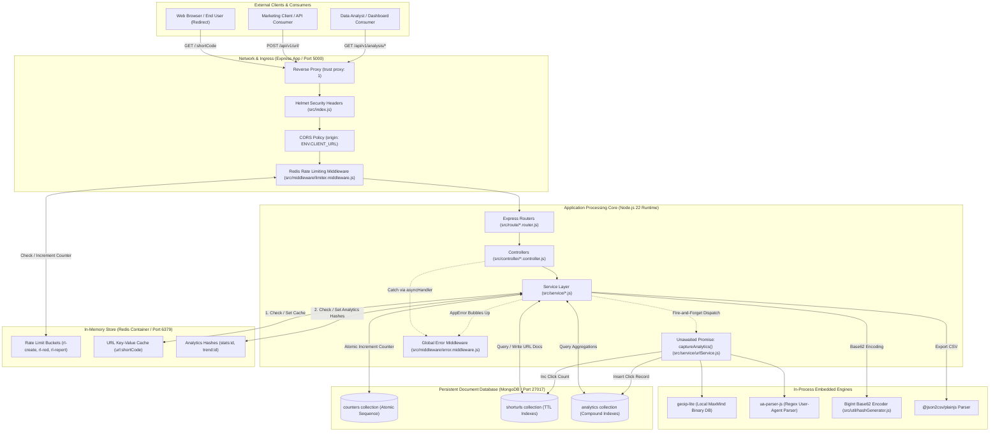
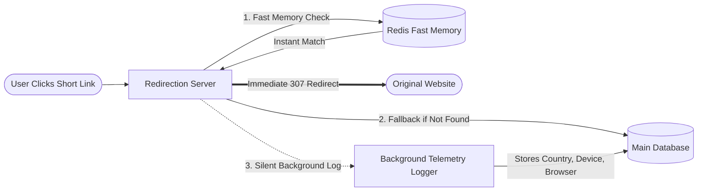
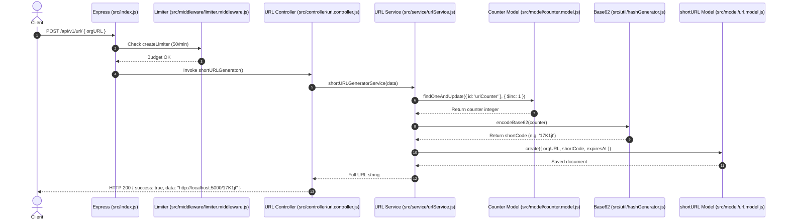
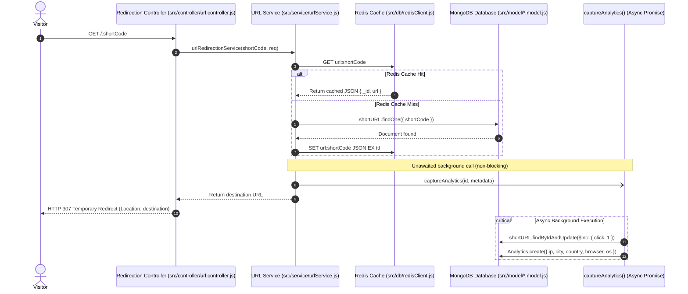
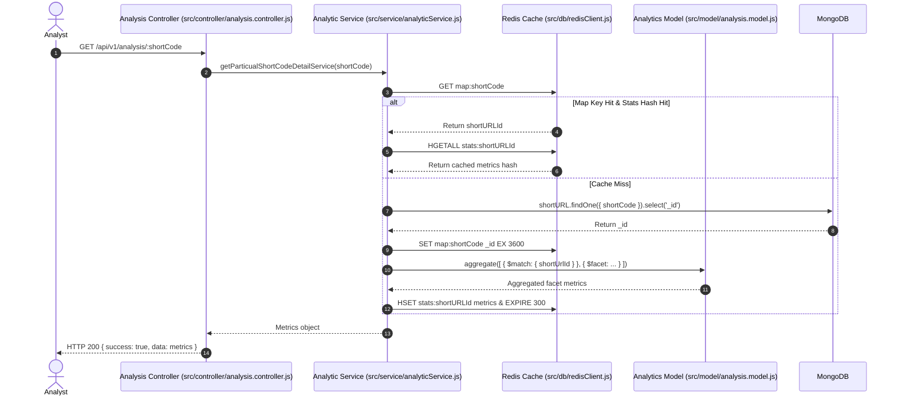
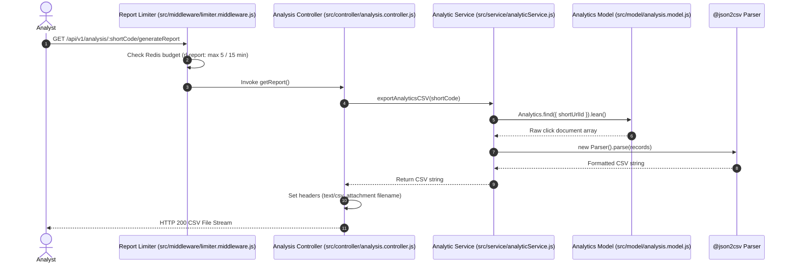

# Architecture Overview: URL Shortener & Analytics System

**Document Version:** 1.0.0  
**Project Name:** `url_shortner`  
**System Type:** Backend RESTful Web Service  
**Target Audience:** Software Architects, Engineering Leads, Full-Stack Developers, and Technical Interview Candidates  
**Companion Document:** `docs/project_requirement_description.md` (PRD)

---

## 1. Architecture Summary

### High-Level Architectural Style
The system follows a **Layered Monolith Architecture** (often referred to as a Multi-Tier Controller-Service-Repository pattern) with an **In-Memory Cache-Aside** layer. It runs as a single Node.js Express process backed by two separate persistence engines:
1. **MongoDB:** The primary document store used for atomic sequence counters, URL metadata, and historical click telemetry.
2. **Redis:** A high-speed in-memory data store used for sub-millisecond redirect lookups, multi-tiered rate limiting, and temporary analytical caching.

The application separates read-heavy, latency-sensitive traffic (URL redirection) from write-heavy telemetry aggregation through an asynchronous, non-blocking background pattern inside the Node.js event loop.

### 30-Second Spoken Pitch (Architecture Edition)
> "Architecturally, this is a layered Node.js and Express REST microservice optimized for high-throughput link redirection. It decouples the critical redirection path from analytics logging: incoming redirects are served directly from an in-memory Redis cache in single-digit milliseconds, while click telemetry—including IP geolocation and device parsing—is handed off to an unawaited asynchronous background promise. Primary persistence is managed in MongoDB using atomic counters for Base62 encoding and TTL indexes for auto-expiration, while multi-level Redis rate limiters protect the system against traffic surges."

### The "Express Drive-Through" Analogy
Think of this system like a **fast-food drive-through window**:
* **The Menu Board (Redis):** The driver pulls up and orders a short code. The attendant checks an instant cheat sheet right in front of them (Redis Cache). If the item is on the cheat sheet, they immediately hand over the food (HTTP 307 redirect) and wave the driver forward in 5 seconds.
* **The Pantry (MongoDB):** If the item isn't on the cheat sheet, the attendant walks back to the main pantry (MongoDB), grabs the recipe, writes it down on the cheat sheet for next time, and hands the driver their food.
* **The Silent Clipboard Auditor (Background Analytics):** As the car drives away, a silent auditor standing in the corner notes down the car's license plate, make, model, and arrival time (`captureAnalytics`). This auditor never makes the driver wait—all note-taking happens after the car has already left the window.

---

## 2. System Diagram

### Technical Architecture Diagram
The diagram below illustrates every component, communication protocol, network boundary, and database connection.



### Simple Non-Technical Diagram
This simplified view illustrates how data flows through the system for non-technical stakeholders:



### Diagram Legend
* **Solid Thick Line (`==>`):** The user's critical path (instant HTTP redirect).
* **Solid Thin Line (`-->`):** Synchronous request/response cycles.
* **Dotted Arrow (`-.->`):** Non-blocking asynchronous background execution or error bubbling.
* **Bidirectional Line (`<-->`):** Read/write roundtrips to persistence stores.

---

## 3. Component Breakdown

### System Component Registry

| Component Name | Job in Simple Words | File / Directory Location | Collaborators & Integrations | Associated Features |
| :--- | :--- | :--- | :--- | :--- |
| **Server Entrypoint** | Initializes security headers, loads environment variables, starts MongoDB, and registers routes. | `src/index.js` | Express, Helmet, CORS, Mongoose, Routers | All Features |
| **Database Connector** | Establishes persistent Mongoose connection to MongoDB. | `src/db/connection.db.js` | MongoDB, Mongoose, Pino Logger | All Features |
| **Redis Client Engine** | Establishes connection to Redis, configures 256MB memory cap, and sets LRU eviction policy. | `src/db/redisClient.js` | Redis, ioredis, Pino Logger | F-3, F-6, F-7, F-9 |
| **Rate Limit Guard** | Tracks client IP request frequency and enforces rate limits using Redis keys. | `src/middleware/limiter.middleware.js` | Redis, `express-rate-limit`, `rate-limit-redis` | F-9 |
| **URL Router & Controller** | Handles endpoints for creating and listing short URLs. | `src/route/url.router.js`, `src/controller/url.controller.js` | `urlService.js`, `limiter.middleware.js` | F-1, F-2, F-10 |
| **Redirection Controller** | Handles `/:shortCode` requests and executes HTTP 307 redirects. | `src/route/redirection.router.js`, `src/controller/url.controller.js` | `urlService.js`, `limiter.middleware.js` | F-3, F-4 |
| **Analytics Controller** | Handles endpoints for global metrics, link stats, trends, and CSV reports. | `src/route/analysis.router.js`, `src/controller/analysis.controller.js` | `analyticService.js`, `@json2csv/plainjs` | F-5, F-6, F-7, F-8 |
| **URL Core Service** | Coordinates URL validation, atomic counter generation, Base62 hashing, and Redis caching. | `src/service/urlService.js` | `counter.model.js`, `url.model.js`, Redis, `geoip-lite`, `ua-parser-js` | F-1, F-2, F-3, F-4 |
| **Analytics Core Service** | Executes MongoDB `$facet` aggregation pipelines and manages analytical cache keys. | `src/service/analyticService.js` | `analysis.model.js`, `url.model.js`, Redis | F-5, F-6, F-7, F-8 |
| **Base62 Algorithm** | Encodes integer counter sequences into compact alphanumeric strings using `BigInt`. | `src/util/hashGenerator.js` | `urlService.js` | F-1 |
| **Error Handling Hub** | Formats operational `AppError` instances into uniform JSON error payloads. | `src/middleware/error.middleware.js`, `src/util/ApiError.js` | Express, Pino Logger | All Features |

---

## 4. Layers and Code Organization

### Standard Architectural Layers
The project organizes code into four primary vertical tiers:

```text
[HTTP Request] 
      │
      ▼
┌────────────────────────────────────────┐
│ 1. ROUTING LAYER                       │
│    Location: src/route/*.router.js     │
│    Role: Path matching, middleware     │
│    binding (rate limiters, headers).   │
└───────────────────┬────────────────────┘
                    │
                    ▼
┌────────────────────────────────────────┐
│ 2. CONTROLLER LAYER                    │
│    Location: src/controller/*.js       │
│    Role: HTTP protocol extraction,     │
│    status codes, formatting responses. │
└───────────────────┬────────────────────┘
                    │
                    ▼
┌────────────────────────────────────────┐
│ 3. SERVICE LAYER                       │
│    Location: src/service/*.js          │
│    Role: Pure business logic, caching, │
│    hashing, external lookups.          │
└───────────────────┬────────────────────┘
                    │
                    ▼
┌────────────────────────────────────────┐
│ 4. DATA ACCESS & MODEL LAYER           │
│    Location: src/model/*.model.js      │
│    Role: Mongoose schemas, indexes,    │
│    TTL expiration rules, validation.   │
└────────────────────────────────────────┘
```

### How a Request Travels Through the Layers
1. **Network Ingress:** An incoming HTTP packet hits `src/index.js`, where `helmet()` sets security headers and `cors()` checks origins.
2. **Rate Limiting:** The request enters `src/middleware/limiter.middleware.js`, incrementing a Redis counter key.
3. **Route Dispatch:** Express matches the path in `src/route/url.router.js` and routes the request to `src/controller/url.controller.js`.
4. **Controller Execution:** Wrapped in `asyncHandler` (`src/util/asyncHandler.js`), the controller parses `req.body` and calls `shortURLGeneratorService` in `src/service/urlService.js`.
5. **Business Logic Execution:** The service validates the URL syntax (`src/util/validation.js`), increments the counter in `src/model/counter.model.js`, converts the value using `encodeBase62` (`src/util/hashGenerator.js`), and persists the record to `src/model/url.model.js`.
6. **Response Formulation:** The service returns a URL string to the controller, which formats it using `ApiResponse` (`src/util/ApiResponse.js`) and returns an HTTP 200 JSON payload.

### Architectural Layer Violations in the Codebase
While the system generally maintains clean boundaries, two significant layer violations exist:

1. **Controller Directly Accessing Database Models (Skipping Service Layer):**
   * **File:** `src/controller/urlList.controller.js` (lines 6–10)
   * **Violation:** The `getAllURLs` controller directly imports `shortURL` from `src/model/url.model.js` and executes queries (`shortURL.find({...}).select(...).sort(...)`) instead of delegating to a method in `src/service/urlService.js`.
   * **Consequence:** Breaks the single-responsibility principle and prevents caching or reusable business rules on link listings.

2. **Service Layer Directly Coupled to HTTP Framework Objects:**
   * **File:** `src/service/urlService.js` (lines 64–70)
   * **Violation:** `urlRedirectionService(shortCode, req)` accepts Express's native `req` object directly to extract `req.ip`, `req.headers['user-agent']`, and `req.headers['referer']`.
   * **Consequence:** The business service cannot be reused in non-HTTP contexts (such as message queues, WebSockets, or background workers) without passing mock Express request objects.

---

## 5. End-to-End Data Flow

### Flow 1: URL Shortening (Feature F-1, F-2)

#### Step-by-Step Execution
1. **Client Action:** Client sends `POST /api/v1/url/` with body `{ "orgURL": "https://example.com/long-page" }`.
2. **Ingress:** `src/index.js` applies `helmet` and `cors`.
3. **Rate Limiting:** `createLimiter` in `src/middleware/limiter.middleware.js` increments Redis key `rl-create:<IP>` (max 50 req/min).
4. **Router:** `src/route/url.router.js` directs request to `shortURLGenerator`.
5. **Controller:** `src/controller/url.controller.js` calls `shortURLGeneratorService(req.body)`.
6. **Validation:** `src/util/validation.js` validates syntax with `validateURL`.
7. **Atomic Sequence Generation:** `src/service/urlService.js` runs `Counter.findOneAndUpdate({ id: 'urlCounter' }, { $inc: { counter: 1 } }, { new: true, upsert: true })`.
8. **Base62 Conversion:** `src/util/hashGenerator.js` passes the sequence integer through `encodeBase62()`.
9. **Persistence:** `src/model/url.model.js` creates a new document with an `expiresAt` date (defaulting to current time + 30 days).
10. **Response Construction:** Controller wraps result in `ApiResponse(200, "Short URL Generated Successfully.", shortUrl)` and sends JSON back to client.

#### Sequence Diagram (URL Shortening)


---

### Flow 2: High-Speed Cached URL Redirection (Feature F-3, F-4)

#### Step-by-Step Execution
1. **Client Action:** Visitor opens `http://localhost:5000/17K1jt` in a browser.
2. **Ingress & Rate Limiting:** Request passes through `redirectLimiter` in `src/middleware/limiter.middleware.js` (max 100 req/min).
3. **Router:** `src/route/redirection.router.js` routes `/:shortCode` to `urlRedirection`.
4. **Controller:** `src/controller/url.controller.js` calls `urlRedirectionService("17K1jt", req)`.
5. **Code Validation:** `src/util/validation.js` runs `validShortCode()`, ensuring length $\ge 4$ and alphanumeric characters only.
6. **Cache Check:** `src/service/urlService.js` queries Redis for `url:17K1jt`:
   * **Cache Hit:** Redis returns `{ _id: "...", url: "https://example.com/long-page" }`.
   * **Cache Miss:** Queries MongoDB (`shortURL.findOne`). If valid, computes remaining TTL seconds and writes to Redis: `redis.set('url:17K1jt', ..., 'EX', ttl)`.
7. **Telemetry Trigger (Non-Blocking):** `urlRedirectionService` calls `captureAnalytics(id, analyticsData)` **without `await`**.
8. **HTTP Redirect:** Controller immediately sends `HTTP 307 Temporary Redirect` with `Location: https://example.com/long-page`.
9. **Background Telemetry Execution:**
   * `geoip-lite` resolves city, country, and region from the IP.
   * `ua-parser-js` resolves browser, OS, and device type.
   * Atomically increments total clicks: `shortURL.findByIdAndUpdate(id, { $inc: { click: 1 } })`.
   * Inserts click document into MongoDB `analytics` collection.

#### Sequence Diagram (Cached Redirection & Async Telemetry)


---

### Flow 3: Single-URL Analytics Retrieval (Feature F-6)

#### Step-by-Step Execution
1. **Client Action:** Client requests `GET /api/v1/analysis/17K1jt`.
2. **Router & Controller:** Hits `src/route/analysis.router.js` $\rightarrow$ `getParticualShortCodeDetail` in `src/controller/analysis.controller.js`.
3. **Service Layer:** Calls `getParticualShortCodeDetailService` in `src/service/analyticService.js`.
4. **Two-Tier Redis Check:**
   * Step 4a: Reads string mapping key `map:17K1jt` from Redis to retrieve MongoDB `_id`.
   * Step 4b: If ID exists, reads Redis hash `stats:<_id>` via `redis.hgetall()`.
   * If cache hit: Parses JSON hash values and returns immediately.
5. **Cache Miss Fallback:**
   * Queries MongoDB: `shortURL.findOne({ shortCode: "17K1jt" }).select('_id')`.
   * Caches short code to ID mapping in Redis: `redis.set('map:17K1jt', id, 'EX', 3600)`.
   * Executes `$facet` aggregation pipeline across the `analytics` collection.
   * Caches aggregated results in Redis hash `stats:<id>` with a 300-second TTL.
6. **Response:** Controller returns `200 OK` with aggregated metric buckets.

#### Sequence Diagram (Single-URL Analytics Retrieval)


---

### Flow 4: CSV Report Export (Feature F-8)

#### Step-by-Step Execution
1. **Client Action:** Client requests `GET /api/v1/analysis/17K1jt/generateReport`.
2. **Rate Limiting:** `reportLimiter` in `src/middleware/limiter.middleware.js` checks Redis key `rl-report:<IP>` (max 5 requests per 15 minutes).
3. **Router & Controller:** Handled by `src/route/analysis.router.js` $\rightarrow$ `getReport` in `src/controller/analysis.controller.js`.
4. **Service Query:** `exportAnalyticsCSV` in `src/service/analyticService.js` queries `Analytics.find({ shortUrlId }).select('ip city country region device browser os referrer clickDate -_id').lean()`.
5. **CSV Transformation:** The plain JavaScript array is processed by `@json2csv/plainjs`'s `Parser`.
6. **HTTP Stream Headers:** Controller sets headers:
   * `Content-Type: text/csv`
   * `Content-Disposition: attachment; filename=report-17K1jt.csv`
7. **Response Delivery:** Sends CSV text body with `200 OK`.

#### Sequence Diagram (CSV Report Generation)


---

## 6. Frontend Architecture

* **Current Status:** **No frontend exists in this repository.**
* **Architectural Implications:**
  * The system is a standalone REST API microservice.
  * Cross-Origin Resource Sharing (CORS) is configured in `src/index.js` (lines 14–19) to accept connections from an external frontend located at `ENV.CLIENT_URL`.
  * The API accepts and returns JSON payloads (`application/json`) with standard `ApiResponse` wrapping, except for the file export endpoint (which returns `text/csv`) and redirection (which returns an HTTP 307 header redirect).

---

## 7. Backend Architecture

### Server Lifecycle & Middleware Execution Pipeline
The Express application boots and processes requests through a defined middleware sequence in `src/index.js`:

```text
[Incoming HTTP Request]
          │
          ▼
┌────────────────────────────────────────┐
│ 1. Proxy Trust Configuration           │
│    app.set('trust proxy', 1)           │
└──────────────────┬─────────────────────┘
                   │
                   ▼
┌────────────────────────────────────────┐
│ 2. HTTP Security Headers               │
│    app.use(helmet())                   │
└──────────────────┬─────────────────────┘
                   │
                   ▼
┌────────────────────────────────────────┐
│ 3. Cross-Origin Resource Sharing       │
│    app.use(cors(corsOptions))          │
└──────────────────┬─────────────────────┘
                   │
                   ▼
┌────────────────────────────────────────┐
│ 4. Body Parsing Middleware             │
│    app.use(express.json())             │
│    app.use(express.urlencoded())       │
└──────────────────┬─────────────────────┘
                   │
                   ▼
┌────────────────────────────────────────┐
│ 5. Endpoint-Specific Rate Limiters     │
│    rl-create: / rl-red: / rl-report:   │
└──────────────────┬─────────────────────┘
                   │
                   ▼
┌────────────────────────────────────────┐
│ 6. Route Dispatchers                   │
│    /api/v1/url                         │
│    /                                   │
│    /api/v1/analysis                    │
└──────────────────┬─────────────────────┘
                   │
                   ▼
┌────────────────────────────────────────┐
│ 7. Global Error Interceptor            │
│    app.use(errorMiddleware)            │
└────────────────────────────────────────┘
```

### Business Logic Decoupling
Business logic is isolated inside `src/service/urlService.js` and `src/service/analyticService.js`. The controllers do not contain SQL/database aggregation queries (with the exception of the `urlList.controller.js` layer violation noted in Section 4). All asynchronous database logic is wrapped using `asyncHandler` (`src/util/asyncHandler.js`), removing repetitive `try/catch` boilerplate from the routing and controller layers.

---

## 8. Authentication and Authorization

* **Current Implementation Status:** **Unauthenticated / Public Access.**
* **Codebase Evidence:**
  * No authorization middleware exists in `src/middleware/`.
  * Routes do not inspect session cookies or bearer tokens (`Authorization` header).
  * In `src/model/url.model.js` (line 15), the schema defines `generatedBy: { type: Schema.Types.ObjectId, ref: 'User' }`, but no associated user controller or registration workflow exists.
  * In `src/util/validation.js`, validation helper schemas for user accounts (`validFullName`, `validEmail`, `validContactNo`, and `validPassword`) exist as commented-out code.
* **Architectural Risk:** Any client on the network can create links, view global analytics dashboards, and export CSV files.

---

## 9. Error Handling and Logging

### Custom Operational Error Class (`AppError`)
Operational errors (expected failures like not-found links, rate limits, or invalid URLs) are managed through the `AppError` class in `src/util/ApiError.js`:

```javascript
// src/util/ApiError.js
export class AppError extends Error {
  constructor(message, statusCode = 500, isOperational = true, success = false) {
    super(message)
    this.statusCode = statusCode
    this.isOperational = isOperational
    this.name = this.constructor.name
    this.success = success
    Error.captureStackTrace(this, this.constructor)
  }
}
```

### Global Error Interceptor Middleware
All errors thrown in controllers or services bubble up to `src/middleware/error.middleware.js`:

```javascript
// src/middleware/error.middleware.js
export const errorMiddleware = (err, req, res, next) => {
  logger.error(`Error: ${err.message}`, {
    stack: err.stack,
    path: req.path,
    method: req.method,
  })

  if (err instanceof AppError) {
    return res.status(err.statusCode).json({
      success: false,
      message: err.message,
    })
  }

  return res.status(500).json({
    success: false,
    message: process.env.NODE_ENV === 'development' ? err.message : 'Internal Server Error',
  })
}
```

### Logging Infrastructure
The system uses `pino` (`src/util/logger.js`), a fast, structured JSON logger for Node.js. 
* System startup events and Redis connection states are logged at `info` level.
* Handled operational failures and unhandled runtime exceptions are logged at `error` level with full stack traces, HTTP paths, and request methods.
* Startup failures (such as database connection drops) trigger an exit with code `1`: `process.exit(1)`.

---

## 10. External Integrations

| Service / Dependency | Architectural Purpose | Calling Location in Code | Error & Fallback Behavior | Configuration Keys |
| :--- | :--- | :--- | :--- | :--- |
| **MongoDB** | Primary persistent store for all documents and sequence counters. | `src/db/connection.db.js` | Critical failure: if MongoDB fails during startup, the process terminates (`process.exit(1)`). | `MONGODB_URI` |
| **Redis** | In-memory cache, rate limiter store, and stats cache. | `src/db/redisClient.js` | Resilient fallback: Redis errors during redirection log an error and fall back to MongoDB. Automatic reconnect with backoff. | `REDIS_URL` |
| **geoip-lite** | Local IP-to-location mapping without network latency. | `src/service/urlService.js` (line 120) | Safe fallback: returns empty object if IP is unresolvable; fields default to `"Unknown"`. | Embedded binary database (no network configuration) |
| **ua-parser-js** | Regex-based User-Agent parsing for device, browser, and OS. | `src/service/urlService.js` (line 122) | Safe fallback: defaults to `"Unknown"` or `"Desktop"` if headers are missing or malformed. | Local dependency (no network configuration) |
| **Nodemailer / Resend** | Email service libraries listed in `package.json`. | Not imported in `src/` | Unused dependency. | None currently configured |

---

## 11. Background Processing and Async Work

* **Task Queue / Broker:** **None found.** The codebase does not use BullMQ, RabbitMQ, SQS, or Redis Pub/Sub.
* **In-Memory Fire-and-Forget Pattern:**
  * **Location:** `src/service/urlService.js` (lines 106–108).
  * **Mechanism:** The `captureAnalytics(finalData._id, analyticsData)` promise is invoked without the `await` keyword.
  * **Error Handling:** Attached via `.catch(err => logger.error('Background Analytics Failed:', err))`.
  * **Architectural Trade-Off:** This ensures single-digit millisecond HTTP redirects, but creates vulnerability to event loss if the Node.js container terminates while background writes are pending in the event loop.

---

## 12. Configuration and Environments

### Environment Variable Management
Environment variables are managed using `dotenv` in `src/util/env.js`:

```javascript
// src/util/env.js
import env from 'dotenv'
env.config()

export const ENV = {
  PORT: process.env.PORT,
  CLIENT_URL: process.env.CLIENT_URL,
  MONGODB_URI: process.env.MONGODB_URI,
  BASE_URL: process.env.BASE_URL,
  REDIS_URL: process.env.REDIS_URL,
}
```

### Environment Configurations

| Environment Key | Development Mode | Production Mode | Testing Mode (`cross-env NODE_ENV=test`) |
| :--- | :--- | :--- | :--- |
| `NODE_ENV` | `development` | `production` | `test` |
| **Error Details** | Stack trace returned in HTTP response | Generic `"Internal Server Error"` returned | Muted / handled by Jest runner |
| **MongoDB** | Standard persistent connection | Production replica set URI | `MongoMemoryServer` (in-memory) |
| **Redis** | Localhost or Docker Redis | Production Redis instance | `RedisMemoryServer` (in-memory) |
| **Start Command**| `nodemon src/index.js` | `node src/index.js` | `jest` |

---

## 13. Deployment and Infrastructure

### Containerization Strategy (`Dockerfile`)
* **Base Image:** `node:22-slim` (minimal Debian distribution for reduced container attack surface and smaller image size).
* **Build Steps:**
  1. Copies `package*.json`.
  2. Runs `npm install --omit=dev` to exclude development dependencies.
  3. Copies application source files.
  4. Exposes application port `5000`.
  5. Runs `npm start`.

### Multi-Container Orchestration (`docker-compose.yaml`)
Orchestrates three interconnected services on a dedicated bridge network (`app-network`):
1. `app-service`: Built from local `Dockerfile`, connects on port `5000:5000`, depends on `db_mongo` and `db_redis`.
2. `db_mongo`: Runs `mongo:latest` on port `27017:27017` with persistent named volume `mongo-data`.
3. `db_redis`: Runs `redis:alpine` with persistent named volume `redis-data`.

---

## 14. Design Decisions

| Architectural Decision | Chosen Pattern | Alternatives Considered | Rationale & Trade-offs |
| :--- | :--- | :--- | :--- |
| **Short Code Generation** | Atomic Mongo Counter + Base62 (`src/util/hashGenerator.js`) | UUIDs, MD5 hashes, random character generation | **Chosen:** Guaranteed zero collision risk; deterministic length growth; compact alphanumeric representations. *[INFERRED]* |
| **Cache-Aside Pattern** | Redis key-value with dynamic TTL (`src/service/urlService.js`) | Direct database queries on every redirect | **Chosen:** Achieves sub-10ms redirects under high concurrency while reducing MongoDB query load. *[INFERRED]* |
| **Asynchronous Telemetry** | Unawaited Promise dispatch (`src/service/urlService.js`) | Synchronous `await` or BullMQ message queue | **Chosen:** Avoids user-facing redirect latency without requiring a separate message broker infrastructure. *[INFERRED]* |
| **Rate Limiting** | Redis-backed fixed window (`rate-limit-redis`) | In-memory token bucket, API Gateway rate limits | **Chosen:** Coordinates rate-limiting counters across multiple container replicas without state fragmentation. *[INFERRED]* |
| **Single-Code Analytics Cache** | Two-tier Redis mapping (String + Hash) | Storing full JSON in a single Redis key | **Chosen:** Maps the short code to MongoDB `_id` once, then caches metrics in Redis hashes with independent TTLs. *[INFERRED]* |

---

## 15. Security Review

### Existing Protections
* **Security Headers (`src/index.js`):** `helmet()` protects against cross-site scripting (XSS), clickjacking, and MIME sniffing.
* **CORS Whitelisting (`src/index.js`):** Restricts resource access to origins defined in `ENV.CLIENT_URL`.
* **Distributed Rate Limiting (`src/middleware/limiter.middleware.js`):** Prevents brute-force access and denial-of-service traffic across link creation, redirection, and reporting.
* **Short Code Sanitization (`src/util/validation.js`):** Enforces strict alphanumeric patterns (`/^[a-zA-Z0-9]+$/`), preventing path traversal, script injection, and SQL/NoSQL injection payloads.
* **Container Hardening (`Dockerfile`):** Built on `node:22-slim` with production dependency filtering (`--omit=dev`).

### Security Gaps and Missing Protections
1. **Unprotected Administrative & Analytical Endpoints:** All `/api/v1/analysis/*` endpoints are publicly accessible without authentication.
2. **PII Storage Risks (GDPR / CCPA):** Raw IP addresses are stored directly in MongoDB without masking or hashing (`src/model/analysis.model.js`).
3. **No Root User Hardening in Docker:** The `Dockerfile` does not declare a non-root `USER node` directive, causing the application to execute as container root.
4. **CORS Misconfiguration Risk:** If `ENV.CLIENT_URL` is omitted or set to `*`, `corsOptions` allows wildcard origins with credentials enabled (`credentials: true`), which violates modern browser security policies.

---

## 16. Scalability and Performance

### Behavior Under 10x Load Surge
* **Redirection Path (`GET /:shortCode`):** Highly resilient. Under 10x traffic, most requests hit Redis cache, keeping latencies under 10ms. Capped at 256MB with `allkeys-lru` eviction policy in `src/db/redisClient.js`.
* **Link Generation (`POST /api/v1/url`):** Protected by Redis rate limiting (50 req/min). If overall user creation surges 10x, MongoDB's atomic `counter` document becomes a write contention point.

### Primary Architectural Bottlenecks
1. **Unqueued MongoDB Telemetry Inserts:** Each click triggers an immediate insert into the `analytics` collection. During a large traffic surge, the MongoDB connection pool can become saturated, degrading database responsiveness across all services.
2. **Heavy Aggregation Pipeline on Global Dashboard:** `getAllDetailsService` in `src/service/analyticService.js` performs an un-cached `$lookup` joining the entire `shorturls` collection with `analytics`. Under high data volumes, this query will cause CPU spikes and slow response times.

---

## 17. Weak Spots and Technical Debt

### Identified Architectural Weaknesses

1. **Fire-and-Forget Promise Telemetry (Event Loss Risk):**
   * **Location:** `src/service/urlService.js` (line 106)
   * **Risk:** If a container restarts or is terminated during auto-scaling, pending analytics promises in the event loop are terminated, causing lost telemetry data.
   * **Recommendation:** Introduce a durable queue (e.g., BullMQ backed by Redis) to buffer click events before writing to MongoDB.

2. **Hardcoded Timezone Offset:**
   * **Location:** `src/service/analyticService.js` (lines 191, 199)
   * **Risk:** The trend aggregation pipeline hardcodes Indian Standard Time (`+05:30`), producing skewed hourly breakdowns for users in other timezones.
   * **Recommendation:** Accept a dynamic timezone parameter from client query strings or store timestamps in UTC.

3. **Orphaned Dependencies & Unused Code:**
   * **Location:** `package.json`, `src/model/emailservice.model.js`
   * **Risk:** `resend` and `nodemailer` add bloat to `node_modules` without serving any functional purpose in the application.
   * **Recommendation:** Remove unused email packages and models until email notifications are actively scheduled for implementation.

4. **Layer Violation in URL Listing:**
   * **Location:** `src/controller/urlList.controller.js`
   * **Risk:** Bypasses the service layer and queries the database model directly from the controller.
   * **Recommendation:** Move query logic into `urlService.js` to maintain consistent architectural layering.

---

## 18. Interview and Explanation Guide

### 2-Minute Spoken Architecture Walkthrough
> "The project is a high-throughput URL shortener and telemetry engine built with Express, MongoDB, and Redis.
>
> When designing for scale, link redirection must be as fast as possible. To achieve this, the system decouples the critical redirection path from analytics tracking.
>
> When a user clicks a short link, the request hits an Express controller that checks Redis first. If cached, it immediately issues an HTTP 307 redirect in single-digit milliseconds. If it's a cache miss, it fetches the destination from MongoDB, computes the remaining TTL, and populates Redis.
>
> To track clicks without delaying the visitor, the controller triggers telemetry as an unawaited background promise. This parses geolocation and device information asynchronously, updating click counts and logging records to MongoDB without blocking the user's redirect.
>
> For link generation, we avoid hash collisions by using an atomic MongoDB sequence counter with Base62 encoding. Redis handles distributed rate limiting, and MongoDB handles persistence with TTL auto-expiration.
>
> The main technical trade-off is that background analytics run directly in the Node.js event loop rather than through a dedicated message queue. At massive scale, we would introduce BullMQ to queue click events before writing them to MongoDB."

---

### 15 Architectural Interview Questions & Answers

#### 1. Why use HTTP 307 instead of HTTP 301 for redirects?
* **Answer:** An HTTP 301 redirect is cached permanently by browsers. If cached locally, subsequent clicks bypass our server entirely, preventing us from recording analytics. An HTTP 307 ensures the browser checks our server on every click while preserving the original request method. *(File: `src/controller/url.controller.js`)*

#### 2. Why Base62 instead of Base64 or MD5 hashing?
* **Answer:** Base64 includes special characters (`+`, `/`, `=`) that require percent-encoding in URLs. MD5 hashes produce 32-character strings, which are too long for a shortener. Base62 uses only alphanumeric characters (`0-9`, `a-z`, `A-Z`), creating compact, URL-safe codes without collision risks. *(File: `src/util/hashGenerator.js`)*

#### 3. How does the system prevent two users from receiving the same short code during concurrent requests?
* **Answer:** It uses MongoDB's atomic `Counter.findOneAndUpdate` operation with `$inc: { counter: 1 }`. This guarantees sequential, collision-free numbers even under high concurrency. *(File: `src/service/urlService.js`)*

#### 4. How are Redis and MongoDB kept in sync when links expire?
* **Answer:** When caching a link in Redis, the service computes the difference between the expiration timestamp and the current time: `remainingTime = (expiresAt - Date.now()) / 1000`. It sets the Redis key with `EX Math.min(remainingTime, 3600)`, ensuring the cache key expires before or at the same time as the MongoDB record. *(File: `src/service/urlService.js`)*

#### 5. What happens if the Redis server goes down? Does the whole service fail?
* **Answer:** No. In `urlRedirectionService`, the Redis lookup is wrapped in a `try/catch` block. If Redis throws a connection error, it logs the failure and falls back to querying MongoDB directly, keeping redirects operational. *(File: `src/service/urlService.js`)*

#### 6. Why is `BigInt` used in the Base62 generator?
* **Answer:** JavaScript's standard `Number` type is an IEEE 754 double-precision float, which loses integer precision above $2^{53} - 1$ (`Number.MAX_SAFE_INTEGER`). Using `BigInt` ensures counter values are encoded accurately regardless of how large the sequence counter grows. *(File: `src/util/hashGenerator.js`)*

#### 7. Is the unawaited `captureAnalytics()` background pattern safe for production?
* **Answer:** *Honest Answer:* It is acceptable for moderate traffic, but has an architectural vulnerability: if the Node.js process crashes or the container restarts, pending analytics writes in the event loop are lost. A production system under high volume should buffer events through a durable queue like BullMQ or Kafka. *(File: `src/service/urlService.js`)*

#### 8. How does the system handle analytics queries for links with millions of clicks?
* **Answer:** Single-link analytics requests use a two-tier Redis cache. The first request runs an aggregation pipeline and caches the results in a Redis hash (`stats:<id>`) with a 300-second TTL. Subsequent requests within that 5-minute window are served directly from Redis memory. *(File: `src/service/analyticService.js`)*

#### 9. Why is the global analytics dashboard (`/api/v1/analysis/`) an architectural bottleneck?
* **Answer:** Unlike the single-link endpoint, the global dashboard query does not use Redis caching. It performs a heavy MongoDB aggregation with `$lookup` and `$unwind` across the entire dataset on every request. Under high traffic, this can saturate database CPU. *(File: `src/service/analyticService.js`)*

#### 10. Why use local `geoip-lite` instead of an external geolocation API?
* **Answer:** External HTTP APIs introduce network latency (50–200ms) and cost per request. `geoip-lite` queries a local binary database in memory, resolving IP lookups in microseconds with zero network overhead. *(File: `src/service/urlService.js`)*

#### 11. Where does the code violate its own layered architecture?
* **Answer:** In `src/controller/urlList.controller.js`, the controller directly imports and queries the Mongoose model (`shortURL.find()`), bypassing the service layer entirely. Additionally, `urlRedirectionService` accepts Express's native `req` object, coupling the business layer to the HTTP framework.

#### 12. How does the rate limiter handle multi-container deployments?
* **Answer:** Instead of in-memory maps, the rate limiters use `rate-limit-redis` as their storage backend. All container instances share the same Redis instance, ensuring request counts are tracked consistently across the entire cluster. *(File: `src/middleware/limiter.middleware.js`)*

#### 13. How does the system handle database memory usage for expired links?
* **Answer:** The `shortURL` schema defines a TTL index: `expiresAt: { type: Date, index: { expires: 0 } }`. MongoDB's background worker thread monitors this index and automatically removes expired documents without requiring manual cron jobs. *(File: `src/model/url.model.js`)*

#### 14. What security risks exist regarding stored analytics data?
* **Answer:** The system stores raw client IP addresses directly in the `analytics` collection without anonymization or hashing. This presents compliance risks under GDPR and CCPA, where IP addresses are classified as personal data. *(File: `src/model/analysis.model.js`)*

#### 15. If tasked with scaling this system to 100 million clicks per day, what architectural changes would you make first?
* **Answer:** First, introduce a message broker (BullMQ with Redis or Kafka) to decouple click capture from MongoDB writes, batch-inserting analytics records every few seconds. Second, add Redis caching to the global analytics dashboard. Third, partition or shard the `analytics` collection by date or URL ID to manage long-term storage growth.

---

## 19. Glossary

* **Cache-Aside Pattern:** A caching strategy where the application checks the cache first; on a miss, it queries the database, updates the cache, and returns the data.
* **Layered Monolith:** An architecture where all application components run inside a single deployable unit, organized into structured tiers (Routes $\rightarrow$ Controllers $\rightarrow$ Services $\rightarrow$ Models).
* **Fire-and-Forget:** An asynchronous execution pattern where a background task is triggered without waiting for its completion, allowing the caller to return a response immediately.
* **Dynamic TTL:** Setting cache expiration dynamically based on external data (in this case, matching the remaining lifespan of the underlying link).
* **Distributed Rate Limiting:** Tracking and enforcing client request limits across multiple application servers using a shared central data store like Redis.
* **TTL Index:** A database index that automatically purges documents once a specified date/time threshold is reached.
* **Compound Index:** A database index spanning multiple document fields (in this system: `{ shortUrlId: 1, clickDate: -1 }`) to accelerate complex queries.

---

## 20. Open Questions

1. **Message Broker for Telemetry Ingestion:**  
   At what traffic threshold should the team migrate from the current unawaited promise pattern to a durable queue (e.g., BullMQ or Kafka)?
2. **User Authentication & Route Protection:**  
   When will the scaffolded `generatedBy` field and user authentication schemas be implemented to secure administrative and analytics endpoints?
3. **Dynamic Client Timezones:**  
   Should the hardcoded `+05:30` (IST) timezone in trend queries be replaced with an optional client timezone parameter?
4. **IP Anonymization Standards:**  
   Should the analytics pipeline hash or truncate client IP addresses prior to database storage to align with GDPR data privacy requirements?
5. **Cleanup of Unused Dependencies:**  
   Can `resend`, `nodemailer`, and `emailservice.model.js` be safely removed from the repository to reduce container footprint?
