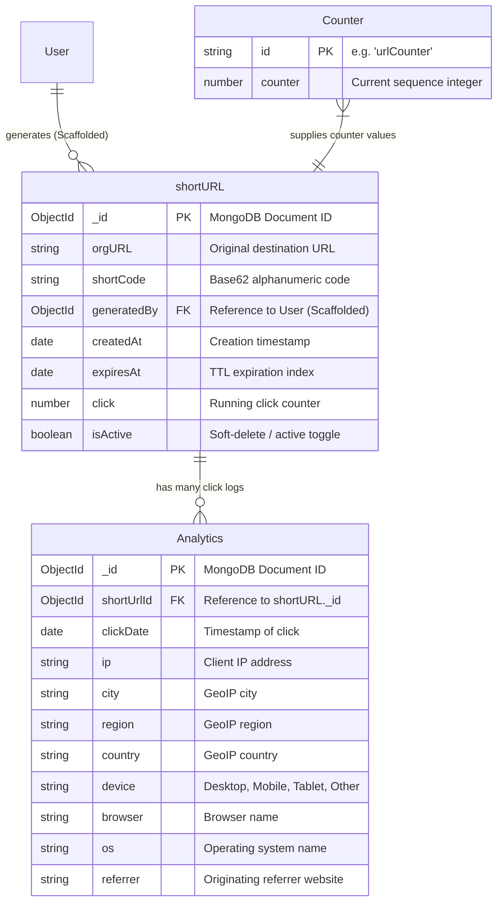
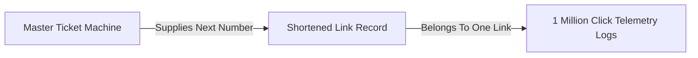

# Data Model & Database Schema: URL Shortener & Analytics System

**Document Version:** 1.0.0  
**Project Name:** `url_shortner`  
**System Type:** Backend RESTful Web Service  
**Target Audience:** Database Engineers, Backend Architects, Full-Stack Developers, and Technical Interview Candidates  
**Companion Documents:** `docs/project_requirement_description.md` (PRD), `docs/architecture_overview.md` (Architecture)

---

## 1. Data Model Summary

### Plain-Language Overview
The system relies on a hybrid data storage model combining **MongoDB** (a NoSQL document database) for persistent relational-like documents and **Redis** (an in-memory data store) for caching and rate limiting. There are 4 defined Mongoose models representing collections in MongoDB: `shortURL` (stores destination links and expiration rules), `Analytics` (stores individual click telemetry events), `Counter` (manages atomic sequence numbers for unique link generation), and `Email` (a scaffolded model for email records). Redis acts as a high-speed secondary layer, storing URL mappings, analytical hash sets, and rate-limiting counters.

### 30-Second Spoken Pitch (Data Model Edition)
> "The data layer uses MongoDB for persistent document storage and Redis for in-memory caching. We maintain four Mongoose collections: `shorturls` for links, `analytics` for raw click logs, `counters` for atomic Base62 generation, and an unused `emails` model. To ensure performance under heavy load, `shortCode` and foreign key `shortUrlId` are indexed, while a MongoDB TTL index automatically purges expired links. Redis caches active links and analytical breakdowns to minimize database read pressure."

### The "Library & Attendance Log" Analogy
Think of this database like a **modern university library**:
* **The Book Catalog (`shortURL` collection):** Every book (original URL) has a unique call number (the Base62 `shortCode`). It records when the book was cataloged and when it is scheduled to be discarded (TTL expiration).
* **The Turnstile Log (`Analytics` collection):** Every time someone walks through the turnstile and opens a book, a library assistant writes down their entry timestamp, city, browser, and device type on a clipboard. Over time, these individual clipboard slips accumulate into millions of historical click logs.
* **The Counter (`Counter` collection):** A master ticket machine that dispenses the next consecutive integer whenever a new book is added, ensuring no two books ever get the same call number.
* **The Express Desk (Redis):** A small sticky-note pad on the front desk containing the 100 most popular books so the librarian doesn't have to walk back to the massive archive shelves every time a student asks for a popular book.

### Database Engine & Configuration
* **Database Type:** NoSQL Document Database (MongoDB) + In-Memory Key-Value Store (Redis).
* **MongoDB Version / Driver:** `mongoose` (^9.2.1) connecting via `src/db/connection.db.js`.
* **Redis Version / Driver:** `ioredis` (^5.9.3) connecting via `src/db/redisClient.js`.

---

## 2. Entity Overview

### Entity Registry Table

| Entity / Collection Name | Purpose in Simple Words | Defining Code File | Associated Feature IDs (F-x) |
| :--- | :--- | :--- | :--- |
| **`Counter`** | Holds a single master sequence number used to generate unique numeric IDs for links. | `src/model/counter.model.js` | F-1 |
| **`shortURL`** | Stores the original destination URL, its short code, click count, status, and expiration. | `src/model/url.model.js` | F-1, F-2, F-3, F-4, F-5, F-10 |
| **`Analytics`** | Stores individual click event logs containing IP, geolocation, device, browser, and OS. | `src/model/analysis.model.js` | F-4, F-5, F-6, F-7, F-8 |
| **`Email`** | Scaffolded schema for storing email notification logs. (Unused in application code). | `src/model/emailservice.model.js` | F-11 (Inactive) |

### Entities Grouped by Domain
1. **Core Business Data:** `shortURL`, `Counter`
2. **Logs and Telemetry:** `Analytics`
3. **Supporting Data:** `Email` (Scaffolded / Inactive)

---

## 3. Entity Relationship Diagram

### Technical ER Diagram (MongoDB Document References)


### Simple Non-Technical Diagram


### Diagram Legend
* **`PK`:** Primary Key (`_id` or unique `id`).
* **`FK`:** Foreign Key reference linking documents across collections.
* **`||--o{`:** One-to-Many relationship (one short URL has zero or many click analytics records).

---

## 4. Detailed Entity Definitions

### 1. `Counter` Entity
* **Purpose:** Represents the atomic sequence generator used to turn consecutive integers into short codes.
* **Field Table:**

| Field Name | Data Type | Required / Optional | Default Value | Constraints & Validation | Description |
| :--- | :--- | :--- | :--- | :--- | :--- |
| `id` | String | Required | None | `unique: true` | Identifier key for the counter (e.g., `'urlCounter'`). |
| `counter` | Number | Optional | `0` | None | The current integer value of the sequence counter. |

* **Primary Key:** `_id` (ObjectId, auto-generated by MongoDB) and `id` (String, unique).
* **Foreign Keys:** None.
* **Defining File:** `src/model/counter.model.js`.
* **Hooks / Virtuals:** None.
* **Example Record (JSON):**
  ```json
  {
    "_id": "60d5ec186641f92e2c8f6c4a",
    "id": "urlCounter",
    "counter": 15420
  }
  ```

---

### 2. `shortURL` Entity
* **Purpose:** Represents a shortened URL pointing to an original web address, including its expiration rules and click tally.
* **Field Table:**

| Field Name | Data Type | Required / Optional | Default Value | Constraints & Validation | Description |
| :--- | :--- | :--- | :--- | :--- | :--- |
| `orgURL` | String | Required | None | None | The destination web address. |
| `shortCode` | String | Required | None | Indexed (`shortCode: 1`) | The unique Base62 alphanumeric string. |
| `generatedBy` | ObjectId | Optional | None | Ref: `'User'`, Indexed | Scaffolded reference linking the link to a user. |
| `createdAt` | Date | Optional | `Date.now` | None | Timestamp when the short link was generated. |
| `expiresAt` | Date | Optional | None | TTL Index (`expires: 0`) | Expiration timestamp; auto-deleted by MongoDB when reached. |
| `click` | Number | Optional | `0` | None | Running total count of all clicks received. |
| `isActive` | Boolean | Optional | `true` | None | Soft-delete / active toggle flag. |

* **Primary Key:** `_id` (ObjectId).
* **Foreign Keys:** `generatedBy` references `User` (scaffolded).
* **Defining File:** `src/model/url.model.js`.
* **Indexes:** 
  * `{ shortCode: 1 }` (`src/model/url.model.js`, line 38)
  * `{ expiresAt: 1 }` with `{ expires: 0 }` (TTL background eviction index)
  * `{ generatedBy: 1 }` (Indexed via schema definition)
* **Example Record (JSON):**
  ```json
  {
    "_id": "65f1a2b3c4d5e6f7a8b9c0d1",
    "orgURL": "https://example.com/very/long/marketing/url",
    "shortCode": "17K1jt",
    "generatedBy": null,
    "createdAt": "2024-05-20T10:00:00.000Z",
    "expiresAt": "2024-06-19T10:00:00.000Z",
    "click": 42,
    "isActive": true
  }
  ```

---

### 3. `Analytics` Entity
* **Purpose:** Represents a single click event logged when a visitor accesses a short URL.
* **Field Table:**

| Field Name | Data Type | Required / Optional | Default Value | Constraints & Validation | Description |
| :--- | :--- | :--- | :--- | :--- | :--- |
| `shortUrlId` | ObjectId | Required | None | Ref: `'shortURL'`, Indexed | Foreign key linking the click to the parent short URL. |
| `clickDate` | Date | Optional | `Date.now` | None | Timestamp of when the click occurred. |
| `ip` | String | Optional | None | None | Visitor's network IP address. |
| `city` | String | Optional | None | None | Geolocation city resolved by `geoip-lite`. |
| `country` | String | Optional | None | None | Geolocation country code. |
| `region` | String | Optional | None | None | Geolocation region/state. |
| `device` | String | Optional | None | Enum: `['Desktop', 'Mobile', 'Tablet', 'Other']` | Hardware device category. |
| `browser` | String | Optional | None | None | Web browser name resolved by `ua-parser-js`. |
| `os` | String | Optional | None | None | Operating system name. |
| `referrer` | String | Optional | `'Direct'` | None | Originating HTTP referrer header. |

* **Primary Key:** `_id` (ObjectId).
* **Foreign Keys:** `shortUrlId` references `shortURL` (`_id`).
* **Defining File:** `src/model/analysis.model.js`.
* **Indexes:** 
  * Compound Index: `{ shortUrlId: 1, clickDate: -1 }` (`src/model/analysis.model.js`, line 28).
  * Single Index on `shortUrlId`.
* **Example Record (JSON):**
  ```json
  {
    "_id": "65f1a3c4d5e6f7a8b9c0d2e3",
    "shortUrlId": "65f1a2b3c4d5e6f7a8b9c0d1",
    "clickDate": "2024-05-20T14:32:10.000Z",
    "ip": "47.15.230.222",
    "city": "Delhi",
    "country": "IN",
    "region": "DL",
    "device": "Desktop",
    "browser": "Chrome",
    "os": "Windows",
    "referrer": "https://twitter.com"
  }
  ```

---

### 4. `Email` Entity (Scaffolded / Inactive)
* **Purpose:** Schema definition for storing email notification logs. Not used in application execution paths.
* **Field Table:**

| Field Name | Data Type | Required / Optional | Default Value | Constraints & Validation | Description |
| :--- | :--- | :--- | :--- | :--- | :--- |
| `emailId` | String | Required | None | None | External or internal email identifier. |
| `from` | String | Required | None | Trimmed | Sender email address. |
| `to` | String | Required | None | Trimmed | Recipient email address. |
| `emailType` | String | Required | None | None | Type or template of the email. |
| `subject` | String | Required | None | None | Email subject line. |
| `content` | String | Required | None | None | HTML or plain-text body content. |

* **Primary Key:** `_id` (ObjectId).
* **Defining File:** `src/model/emailservice.model.js`.

---

## 5. Relationships Explained

### Relationship Registry

| Parent Entity | Child Entity | Relationship Type | Foreign Key Field | Real-Life Meaning | On Delete Behavior |
| :--- | :--- | :--- | :--- | :--- | :--- |
| **`shortURL`** | **`Analytics`** | One-to-Many | `Analytics.shortUrlId` $\rightarrow$ `shortURL._id` | One short link accumulates many historical click telemetry logs. | **Restricted / None** (Mongoose does not enforce cascading deletes automatically; deleted short URLs leave orphan analytics records unless explicitly cleaned up). |
| **`User` (Scaffolded)** | **`shortURL`** | One-to-Many | `shortURL.generatedBy` $\rightarrow$ `User._id` | One registered user owns zero or many generated short URLs. | **None** (User model does not exist in code). |

---

## 6. Indexes and Constraints

### Active Indexes in the Codebase

1. **`shortURL` Collection:**
   * `{ shortCode: 1 }`: Unique lookup index for fast redirection (`src/model/url.model.js`, line 38).
   * `{ expiresAt: 1 }` with `{ expires: 0 }`: TTL background index enabling MongoDB to automatically purge expired documents (`src/model/url.model.js`, line 21).
   * `{ generatedBy: 1 }`: Index on scaffolded user ownership field (`src/model/url.model.js`, line 15).

2. **`Analytics` Collection:**
   * `{ shortUrlId: 1 }`: Foreign key index accelerating analytical lookups and aggregations per short code (`src/model/analysis.model.js`, line 10).
   * Compound Index `{ shortUrlId: 1, clickDate: -1 }`: Optimizes sorted time-series lookups and faceted grouping pipelines (`src/model/analysis.model.js`, line 28).

3. **`Counter` Collection:**
   * `{ id: 1 }`: Unique index on counter identifier (`src/model/counter.model.js`, line 7).

### Unindexed Search Fields (Identified Gaps)
* **`shortURL.orgURL`:** Not indexed. If an administrator searches for short URLs by destination URL, MongoDB performs a full collection scan. (Severity: Low, as lookups are almost exclusively by `shortCode`).

---

## 7. Enums, Status Values, and Lookup Data

### Allowed Values & Status Constants

1. **`Analytics.device` (Hardware Category):**
   * **Allowed Enum Values:** `['Desktop', 'Mobile', 'Tablet', 'Other']` (`src/model/analysis.model.js`, line 19).
   * **Fallback:** Defaults to `'Desktop'` when `ua-parser-js` cannot determine hardware type (`src/service/urlService.js`, line 140).

2. **`shortURL.isActive` (Soft-Delete Flag):**
   * **Allowed Values:** `true` (Active) or `false` (Deactivated).
   * **Behavior:** When `isActive` is `false`, `urlRedirectionService` rejects access with `404 Not Found` (`src/service/urlService.js`), and analytical aggregations exclude the record (`src/service/analyticService.js`).

3. **`Analytics.referrer` (Traffic Origin):**
   * **Allowed Values:** Any HTTP referer string.
   * **Default:** `'Direct'` when `req.headers['referer']` is missing (`src/model/analysis.model.js`, line 24).

---

## 8. Migrations and Schema History

* **Migration Tool:** **None found.** The repository does not use migration runners like `migrate-mongo`, Sequelize CLI, or Prisma Migrate.
* **Schema Initialization:** Mongoose handles schema compilation dynamically on application startup via `connectDB()` in `src/db/connection.db.js`. Indexes defined in Mongoose schemas (such as TTL indexes and compound indexes) are ensured automatically by MongoDB when Mongoose connects.
* **Seed Files:** **None found.** No database seed scripts exist in the repository.

---

## 9. Data Lifecycle by Entity

### 1. `Counter` Entity Lifecycle
* **Creation:** Automatically created via `upsert: true` on the first link generation request (`src/service/urlService.js`, line 34).
* **Updates:** Incrementally updated on every link generation via `$inc: { counter: 1 }`.
* **Deletion:** Never deleted.

### 2. `shortURL` Entity Lifecycle
* **Creation:** Created via `shortURL.create(...)` when a client calls `POST /api/v1/url/` (`src/service/urlService.js`).
* **Updates:** 
  * Click count increments via `shortURL.findByIdAndUpdate(id, { $inc: { click: 1 } })` during redirection (`src/service/urlService.js`, line 133).
  * Status updates if marked inactive (`isActive: false`).
* **Deletion:** 
  * Automatically purged by MongoDB background worker threads when `expiresAt` is reached (TTL index).
  * No manual delete endpoints exist in the API router.

### 3. `Analytics` Entity Lifecycle
* **Creation:** Created via `Analytics.create(...)` in the unawaited background analytics capture function during every successful link redirect (`src/service/urlService.js`, line 136).
* **Updates:** Immutable logs (never updated after creation).
* **Deletion:** Never deleted by application code.

---

## 10. Data Flow by Feature

### Feature-to-Entity Mapping Table

| Feature ID | Feature Name | Entities Read | Entities Written | Primary Database Queries / Operations |
| :--- | :--- | :--- | :--- | :--- |
| **F-1** | Atomic Base62 Short URL Generation | `Counter`, `shortURL` | `Counter`, `shortURL` | `Counter.findOneAndUpdate()`, `shortURL.create()` |
| **F-2** | Configurable URL Expiration (TTL) | None | `shortURL` | Sets `expiresAt` date field on document creation |
| **F-3** | Sub-10ms Cached Redirection | `shortURL` (Redis + Mongo) | None | Redis `GET url:<code/>`, MongoDB `shortURL.findOne()` |
| **F-4** | Non-Blocking Click Telemetry Capture | None | `shortURL`, `Analytics` | `shortURL.findByIdAndUpdate($inc)`, `Analytics.create()` |
| **F-5** | Global Multi-Faceted Analytics Dashboard | `shortURL`, `Analytics` | None | `shortURL.aggregate([ { $match }, { $lookup }, { $facet } ])` |
| **F-6** | Single-Code Cached Analytics Breakdown | `shortURL`, `Analytics` (Redis + Mongo) | None | Redis `GET map:<code/>`, Redis `HGETALL stats:<id>`, MongoDB `Analytics.aggregate()` |
| **F-7** | Hourly and Daily Trend Telemetry | `shortURL`, `Analytics` (Redis + Mongo) | None | Redis `GET trend:<code/>`, MongoDB `Analytics.aggregate()` with `$hour` & `$dateToString` |
| **F-8** | CSV Analytics Report Export | `shortURL`, `Analytics` | None | `shortURL.findOne()`, `Analytics.find().lean()` |
| **F-9** | Multi-Tier Redis Rate Limiting | None (Redis only) | Redis (Rate limit keys) | Redis `INCR` and `EXPIRE` commands via `rate-limit-redis` |
| **F-10** | Active URL Listing | `shortURL` | None | `shortURL.find({ isActive: true }).sort({ createdAt: -1 })` |

---

## 11. Queries and Data Access Patterns

### How the Code Talks to the Database
All database interactions occur through **Mongoose ODM** queries and aggregation pipelines (`src/model/*.model.js`), wrapped inside service functions (`src/service/*.js`) and controller handlers (`src/controller/*.js`). Caching operations interface directly with Redis using `ioredis` (`src/db/redisClient.js`).

### The 10 Most Important Queries Explained

#### 1. Atomic Counter Increment (`src/service/urlService.js`, line 34)
* **In Simple Words:** "Find the counter document named `urlCounter`, add 1 to its counter number, and create it with 1 if it doesn't already exist."
* **Mongoose Code:**
  ```javascript
  const counter = await Counter.findOneAndUpdate(
    { id: 'urlCounter' },
    { $inc: { counter: 1 } },
    { new: true, upsert: true }
  )
  ```

#### 2. Short URL Creation (`src/service/urlService.js`, line 46)
* **In Simple Words:** "Insert a new link document containing the original URL, short code, and expiration date into the `shorturls` collection."
* **Mongoose Code:**
  ```javascript
  const savedLink = await shortURL.create({ orgURL: url, shortCode, expiresAt })
  ```

#### 3. Redirection Lookup (`src/service/urlService.js`, line 91)
* **In Simple Words:** "Find the active, non-expired short URL document matching this short code."
* **Mongoose Code:**
  ```javascript
  const originalURL = await shortURL.findOne({ shortCode: validatedCode })
  ```

#### 4. Asynchronous Click Counter Increment (`src/service/urlService.js`, line 133)
* **In Simple Words:** "Find the parent short URL document by its ID and add 1 to its `click` count."
* **Mongoose Code:**
  ```javascript
  await shortURL.findByIdAndUpdate(orgUrlId, { $inc: { click: 1 } })
  ```

#### 5. Click Telemetry Log Insertion (`src/service/urlService.js`, line 136)
* **In Simple Words:** "Insert a new click record containing IP, geolocation, device, and browser metadata into the `analytics` collection."
* **Mongoose Code:**
  ```javascript
  await Analytics.create({ shortUrlId: orgUrlId, ip, city, region, country, browser, os, referrer, device })
  ```

#### 6. Global Multi-Faceted Analytics Aggregation (`src/service/analyticService.js`, line 10)
* **In Simple Words:** "Find all active links, join them with their click logs, and calculate 8 different analytical groupings (by country, city, device, browser, OS, referrer, and top clicked links) in a single database pass."
* **Mongoose Code:**
  ```javascript
  const result = await shortURL.aggregate([
    { $match: { isActive: true } },
    { $lookup: { from: 'analytics', localField: '_id', foreignField: 'shortUrlId', as: 'analyticsData' } },
    { $unwind: '$analyticsData' },
    { $facet: { categorizedByRegion: [{ $group: { _id: '$analyticsData.region', total: { $sum: 1 } } }], ... } }
  ])
  ```

#### 7. Single-Link Analytics Aggregation (`src/service/analyticService.js`, line 109)
* **In Simple Words:** "Find all click logs belonging to this specific link ID and group them by region, country, city, referrer, device, browser, and OS."
* **Mongoose Code:**
  ```javascript
  const shortCodeDetail = await Analytics.aggregate([
    { $match: { shortUrlId: shorturlDetail._id } },
    { $facet: { categorizedByRegion: [{ $group: { _id: '$region', total: { $sum: 1 } } }], ... } }
  ])
  ```

#### 8. Trend Time-Series Aggregation (`src/service/analyticService.js`, line 211)
* **In Simple Words:** "Match click logs for this link ID and group the clicks by hour of the day (in IST +05:30) and calendar date."
* **Mongoose Code:**
  ```javascript
  const getTrendInfo = await Analytics.aggregate([
    { $match: { shortUrlId: shortURLInfo._id } },
    { $facet: {
        perHourClick: [{ $group: { _id: { $hour: { date: '$createdAt', timezone: '+05:30' } }, totalClick: { $sum: 1 } } }],
        perDayClick: [{ $group: { _id: { $dateToString: { format: '%Y-%m-%d', date: '$createdAt', timezone: '+05:30' } }, totalClick: { $sum: 1 } } }]
      }
    }
  ])
  ```

#### 9. CSV Export Raw Query (`src/service/analyticService.js`, line 273)
* **In Simple Words:** "Find all raw click documents for this short link, select specific telemetry fields, exclude internal ID fields, and return plain JavaScript objects."
* **Mongoose Code:**
  ```javascript
  const shortCodeDetails = await Analytics.find({ shortUrlId: shortCodeInfo })
    .select('ip city country region device browser os referrer clickDate -_id')
    .lean()
  ```

#### 10. Active URL Listing Query (`src/controller/urlList.controller.js`, line 8)
* **In Simple Words:** "Find all active links, select specific fields, and sort them from newest to oldest."
* **Mongoose Code:**
  ```javascript
  const urls = await shortURL.find({ isActive: true })
    .select('orgURL shortCode click createdAt lastClickedAt')
    .sort({ createdAt: -1 })
  ```

### N+1 Query Risks & Performance Bottlenecks
* **Zero N+1 Risks in Redirection:** Redirection queries are O(1) via Redis cache or indexed MongoDB `findOne()`.
* **Global Dashboard `$lookup` Bottleneck:** The global analytics dashboard (`getAllDetailsService`) performs a `$lookup` joining `shorturls` and `analytics` followed by an `$unwind`. On high-volume production databases with millions of click records, this query will cause heavy memory usage and CPU saturation.

---

## 12. Validation and Data Integrity

### Validation Tiers

1. **API / Routing Tier (Rate Limiting):**
   * Enforced via `express-rate-limit` and `rate-limit-redis` (`src/middleware/limiter.middleware.js`), protecting endpoints against abuse.

2. **Service / Validation Tier (`src/util/validation.js`):**
   * **URL Validation (`validateURL`):** Rejects URLs containing double dots (`..`), checks protocol headers (`http://` / `https://`), and cleans search/hash parameters.
   * **Short Code Validation (`validShortCode`):** Enforces a minimum length of 4 characters and checks strict alphanumeric regex (`/^[a-zA-Z0-9]+$/`). Rejects invalid codes with status `406 Not Acceptable`.

3. **Database Schema Tier (Mongoose Models):**
   * `required: true` constraints on `orgURL`, `shortCode`, and `shortUrlId`.
   * Enum validation on `Analytics.device` (`['Desktop', 'Mobile', 'Tablet', 'Other']`).
   * Unique indexes on `shortCode` and `Counter.id`.

### Validation Gaps
* **Missing URL Reachability Check:** The system validates URL syntax (`validateURL`), but does not verify whether the destination web address actually exists or returns a 200 OK response before shortening it.

---

## 13. Sensitive Data and Privacy

### Sensitive Fields & Protection Mechanisms

1. **Client IP Addresses (`Analytics.ip`):**
   * **Sensitivity:** Classified as personal identifying information (PII) under GDPR and CCPA regulations.
   * **Protection Status:** **Unprotected / Raw Storage.** IP addresses are stored in plain text in the `Analytics` collection (`src/model/analysis.model.js`).
   * **Leakage Risk:** Exposed in downloadable CSV reports (`src/service/analyticService.js`) and raw aggregation responses.

2. **Authentication Credentials:**
   * **Status:** No passwords, API keys, or JWT tokens are stored in the database because user authentication is unimplemented.

---

## 14. Non-Database Data Storage

### 1. Redis In-Memory Store (`src/db/redisClient.js`)
* **Purpose:** Acts as a high-speed secondary data store and cache.
* **Stored Data Structures:**
  * **URL Cache:** Key `url:<shortCode>` storing JSON strings `{ _id, url }` with dynamic TTL (capped at 3600 seconds).
  * **Single-Link Analytics Map:** Key `map:<shortCode>` storing MongoDB `shortURLId` strings (TTL 3600s).
  * **Single-Link Analytics Stats Hash:** Key `stats:<shortURLId>` storing stringified aggregation facet data (TTL 300s).
  * **Trend Analytics Hash:** Key `trend:<shortURLId>` storing stringified trend metrics (TTL 300s).
  * **Rate Limiting Buckets:** Keys prefixed with `rl-create:`, `rl-red:`, and `rl-report:` tracking request counts and window expiration.

---

## 15. Backup, Performance, and Scaling

### Backup and Recovery
* **Repository Status:** **Not found in repo.** No automated backup scripts, mongodump configurations, or point-in-time recovery workflows exist in the repository.

### Behavior Under 10x Data Scale
* **`shortURL` Collection:** Highly scalable due to indexing on `shortCode` and TTL indexes.
* **`Analytics` Collection:** Will experience significant performance degradation under 10x growth because click logs append continuously without a time-series sharding strategy, collection capping, or log rotation.
* **Redis Memory:** Protected against out-of-memory crashes by configuration: `maxmemory 256mb` and `maxmemory-policy allkeys-lru` (`src/db/redisClient.js`).

---

## 16. Data Model Review: Problems and Improvements

| Issue / Architectural Flaw | Defining File | Why It Matters | Suggested Fix |
| :--- | :--- | :--- | :--- |
| **Orphaned Analytics Records** | `src/model/analysis.model.js` | When a short URL is deleted or expires via TTL, its corresponding `analytics` click logs remain orphaned in MongoDB, wasting storage. | Implement Mongoose pre-remove hooks or scheduled cleanup scripts to cascade-delete analytics when parent short URLs are removed. |
| **Unmasked IP Addresses (PII)** | `src/model/analysis.model.js` | Storing raw client IPs violates data privacy laws (GDPR/CCPA). | Anonymize IP addresses before writing to database (e.g., zeroing out the final IPv4 octet). |
| **Dead Field (`lastClickedAt`)** | `src/controller/urlList.controller.js` | The active URL listing controller queries `lastClickedAt`, but the field is missing from `url.model.js` and never updated. | Either add `lastClickedAt` to `url.model.js` and update it in `captureAnalytics`, or remove it from the query projection. |
| **Hardcoded IST Timezone in Aggregations** | `src/service/analyticService.js` | Trend groupings hardcode `+05:30`, rendering hourly charts inaccurate for global users. | Accept dynamic timezone offsets from client query parameters. |

---

## 17. Interview and Explanation Guide

### 2-Minute Spoken Data Model Walkthrough
> "The data layer is built around MongoDB for persistence and Redis for caching, structured into four core Mongoose models.
>
> The primary entity is `shortURL`, which stores destination links and uses a MongoDB TTL index to automatically delete expired links. To generate short codes without collisions, we maintain a `Counter` collection that increments an atomic integer sequence on every request. This integer is then converted to a Base62 string.
>
> Every time a user clicks a short link, our background telemetry engine logs a record in the `Analytics` collection, linking it to the parent short link via an indexed foreign key `shortUrlId`. We use compound indexes on `{ shortUrlId: 1, clickDate: -1 }` to accelerate faceted aggregations.
>
> For performance, we use Redis as a cache-aside layer. Redirections check Redis first for sub-millisecond responses, while single-link analytics use a two-tier Redis mapping and hash cache with a 5-minute TTL.
>
> The main data model trade-offs are that raw client IP addresses are stored without anonymization, and analytics records are not automatically cascade-deleted when parent URLs expire."

---

### 20 Database & Data Design Interview Questions & Answers

#### 1. Why use MongoDB instead of a relational database like PostgreSQL for a URL shortener?
* **Answer:** A URL shortener requires rapid, highly scalable writes for click telemetry and simple key-value lookups for redirection. MongoDB's document model and horizontal scaling capabilities fit this workload well, while Mongoose provides flexible schema modeling. *(File: `src/model/url.model.js`)*

#### 2. How does the `Counter` collection prevent race conditions during concurrent link creation?
* **Answer:** It uses MongoDB's atomic `Counter.findOneAndUpdate` operation with `$inc: { counter: 1 }` and `upsert: true`. This operation is atomic at the database engine level, preventing two concurrent requests from receiving the same counter value. *(File: `src/service/urlService.js`)*

#### 3. How do expired short links get cleaned up from MongoDB?
* **Answer:** We define a TTL (Time-to-Live) index on the `expiresAt` field: `{ expiresAt: 1 }` with `{ expires: 0 }`. MongoDB's background thread periodically inspects this index and automatically deletes expired documents without requiring manual cron jobs. *(File: `src/model/url.model.js`)*

#### 4. What is the purpose of the compound index on the `Analytics` collection?
* **Answer:** The compound index `{ shortUrlId: 1, clickDate: -1 }` optimizes analytical queries by allowing MongoDB to quickly filter click records by a specific short URL ID and sort them chronologically in descending order. *(File: `src/model/analysis.model.js`)*

#### 5. Why store analytics in a separate collection instead of embedding click arrays inside the `shortURL` document?
* **Answer:** Storing clicks in a separate `analytics` collection prevents document size bloat. MongoDB documents have a strict 16MB size limit. If a viral link receives millions of clicks, embedding them would quickly exceed the limit and cause write failures. *(File: `src/model/analysis.model.js`)*

#### 6. What happens to analytics records when a parent short URL expires or is deleted?
* **Answer:** *Honest Answer:* Currently, nothing happens. Mongoose does not enforce cascading deletes by default, leaving orphaned click records in the `analytics` collection. A production fix would add a pre-remove hook or scheduled cleanup job. *(File: `src/model/analysis.model.js`)*

#### 7. How does Redis caching work alongside MongoDB for URL redirection?
* **Answer:** We use a Cache-Aside pattern. When a user requests a short link, we check Redis (`url:<code/>`) first. If cached, we return the URL immediately. If not, we query MongoDB, cache the result in Redis with a dynamic TTL matching the remaining link lifespan, and return it. *(File: `src/service/urlService.js`)*

#### 8. What is the risk of storing raw client IP addresses in the `Analytics` collection?
* **Answer:** Storing raw IP addresses presents compliance risks under data privacy regulations like GDPR and CCPA, where IP addresses are classified as personal data. A production system should anonymize IPs before storage. *(File: `src/model/analysis.model.js`)*

#### 9. How does the single-code analytics cache avoid stale data?
* **Answer:** Single-link analytics results are stored in Redis hashes (`stats:<id>`) with a strict 5-minute TTL (`expire(statsKey, 300)`). After 5 minutes, the cache expires, forcing the system to re-query MongoDB for fresh aggregated metrics. *(File: `src/service/analyticService.js`)*

#### 10. Why are migrations absent from this repository?
* **Answer:** *Honest Answer:* This project relies on Mongoose's dynamic schema compilation rather than explicit migration scripts. When the application boots, Mongoose ensures indexes and schemas match the code definitions upon connection. *(File: `src/db/connection.db.js`)*

#### 11. What is an N+1 query problem, and does this codebase suffer from it?
* **Answer:** An N+1 query problem occurs when an application executes 1 query to fetch a parent list and N separate queries to fetch related child records. This codebase avoids N+1 queries during redirection by using direct key lookups, but the global analytics dashboard uses a single heavy MongoDB `$facet` aggregation instead of iterative queries. *(File: `src/service/analyticService.js`)*

#### 12. How does the `.lean()` method improve performance in `exportAnalyticsCSV`?
* **Answer:** Mongoose queries normally return heavy Mongoose Document instances wrapped with change-tracking methods and virtual getters. Calling `.lean()` instructs Mongoose to return plain JavaScript objects, reducing memory overhead and speeding up CSV parsing. *(File: `src/service/analyticService.js`)*

#### 13. What is the architectural purpose of the `lastClickedAt` field in `urlList.controller.js`?
* **Answer:** *Honest Answer:* It appears to be an unimplemented or dead field. While the controller queries and projects `lastClickedAt`, the field is never defined in `url.model.js` and is never updated during click capture, causing it to return `null`. *(File: `src/controller/urlList.controller.js`)*

#### 14. How does MongoDB `$facet` work in the analytics aggregation pipeline?
* **Answer:** The `$facet` operator allows the database to process multiple analytical grouping pipelines in parallel over the same set of documents within a single database pass, computing metrics like country, city, and device breakdowns simultaneously. *(File: `src/service/analyticService.js`)*

#### 15. Why does `urlRedirectionService` calculate a dynamic TTL when caching links in Redis?
* **Answer:** If we cached links with a static 1-hour TTL, an expired link might still be served from Redis cache after its expiration date. Calculating `Math.min(remainingTime, 3600)` ensures the Redis cache key expires precisely when the link expires in MongoDB. *(File: `src/service/urlService.js`)*

#### 16. What validation safeguards prevent malicious URL injection?
* **Answer:** The `validateURL` utility checks URL string formats, rejects consecutive dots (`..`), verifies protocol prefixes (`http://` / `https://`), and parses URLs through the native `URL` constructor to ensure clean output. *(File: `src/util/validation.js`)*

#### 17. How does the system handle timezones in trend analytics?
* **Answer:** The MongoDB aggregation pipeline hardcodes the timezone offset to Indian Standard Time (`+05:30`) using `{ $hour: { date: '$createdAt', timezone: '+05:30' } }`. *(File: `src/service/analyticService.js`)*

#### 18. What would happen to Redis memory usage if millions of short codes were generated without limits?
* **Answer:** Redis is protected by two safeguards: short URLs cached in Redis have dynamic TTLs (expiring within an hour), and Redis is configured with `maxmemory 256mb` and `maxmemory-policy allkeys-lru`, automatically evicting the least recently used keys when memory fills up. *(File: `src/db/redisClient.js`)*

#### 19. Why does `src/controller/urlList.controller.js` violate architectural layering?
* **Answer:** It violates layering by importing the Mongoose model (`shortURL`) directly into the controller and executing queries (`shortURL.find()`), bypassing the service layer (`src/service/urlService.js`). *(File: `src/controller/urlList.controller.js`)*

#### 20. If you were to add user accounts to this database schema, how would you link short URLs to users?
* **Answer:** We would create a `User` model, implement user registration/login, and utilize the already scaffolded `generatedBy` ObjectId reference field in `src/model/url.model.js`, indexing it to allow users to query and manage their own created links. *(File: `src/model/url.model.js`)*

---

## 18. Glossary

* **NoSQL Document Database:** A database that stores data in flexible, JSON-like documents rather than rigid relational tables and rows (e.g., MongoDB).
* **Mongoose ODM:** An Object Data Modeling library for MongoDB and Node.js that manages data relationships, provides schema validation, and translates objects to Mongo documents.
* **TTL Index (Time-To-Live Index):** A special MongoDB index that automatically removes documents from a collection after a specified amount of time or at a specific date.
* **Compound Index:** An index created on multiple fields of a database collection, optimizing queries that filter or sort by those fields together.
* **Cache-Aside Pattern:** A caching architecture where the application checks the cache first; on a miss, it queries the primary database, populates the cache, and returns the result.
* **Lean Query (`.lean()`):** A Mongoose query option that returns plain JavaScript objects instead of full Mongoose documents, reducing memory consumption and improving performance.
* **Upsert:** An atomic database operation that updates an existing record if it matches a query condition, or inserts a new record if no match is found.
* **Orphaned Record:** A child document in a database whose parent document has been deleted, leaving a foreign reference pointing to a non-existent record.

---

## 19. Open Questions

1. **Orphaned Analytics Cleanup:**  
   Should we implement Mongoose pre-remove hooks or cron jobs to automatically delete click analytics when a parent short URL expires or is deleted?
2. **IP Anonymization for Privacy Compliance:**  
   How should the team modify `src/model/analysis.model.js` and `captureAnalytics` to mask client IP addresses to comply with GDPR and CCPA privacy standards?
3. **Dead Field Cleanup (`lastClickedAt`):**  
   Should `lastClickedAt` be fully implemented in `url.model.js` and updated during click tracking, or should it be removed from `urlList.controller.js`?
4. **Dynamic Timezones in Trend Aggregations:**  
   Should the hardcoded `+05:30` IST timezone offset in analytical trend pipelines be replaced with dynamic timezone parameters from client requests?
5. **Database Migration Strategy:**  
   Should the project introduce a migration tool (such as `migrate-mongo`) as the data model evolves, or continue relying entirely on Mongoose dynamic schema compilation?
