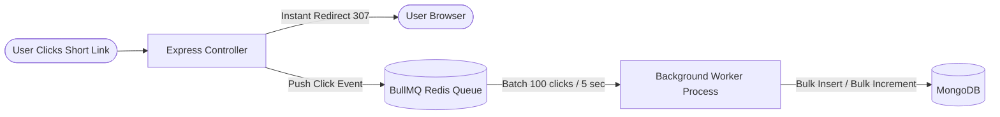

# Comprehensive System Audit: Flaws, Missing Features, and Strategic Improvement Roadmap

**Document Version:** 1.0.0  
**Project Name:** `url_shortner`  
**System Type:** Backend RESTful Microservice  
**Author / Persona:** Senior Systems Analyst & Principal Software Architect  
**Companion Documents:**  
* Document 1: `docs/project_requirement_description.md` (PRD)  
* Document 2: `docs/architecture_overview.md` (Architecture Overview)  
* Document 3: `docs/tech_stack_and_dependencies.md` (Tech Stack & Dependencies)  
* Document 4: `docs/data_model_and_database_schema.md` (Data Model & Database Schema)  
* Document 5: `docs/api_interface_spec.md` (API & Interface Specification)  
* Document 6: `docs/implementation_rules_and_roadmap.md` (Implementation Rules & Roadmap)

---

## 1. Executive Summary & Codebase Health Scorecard

### Architectural Health Overview
The `url_shortner` codebase demonstrates strong foundational choices: native ES modules, Express 5, BigInt-safe Base62 encoding, an in-memory cache-aside Redis layer for high-speed redirects, distributed rate limiting, and an isolated in-memory testing harness (`mongodb-memory-server` and `redis-memory-server`).

However, an exhaustive audit of the source code reveals that the project currently sits at an **advanced prototype / MVP stage**. It is not yet enterprise production-ready. Critical security controls are absent, background telemetry relies on a fragile in-memory pattern that risks data loss, database aggregation queries are vulnerable to denial-of-service spikes, and multiple planned features (authentication, email dispatch) remain abandoned as dead scaffolding.

### System Scorecard

| Category | Score (1–10) | Evaluation & Key Drivers |
| :--- | :---: | :--- |
| **Core Redirection Latency** | **8.5 / 10** | **Strong.** Redis caching and HTTP 307 headers deliver sub-10ms redirection on cache hits. |
| **Short Code Generation** | **9.0 / 10** | **Excellent.** Atomic MongoDB sequence counter with BigInt Base62 encoding prevents race conditions. |
| **Data Integrity & Schema** | **5.5 / 10** | **Needs Work.** Orphaned analytics records persist forever; dead fields exist; no database migration tooling. |
| **Scalability & Queuing** | **4.0 / 10** | **Critical Weakness.** In-memory fire-and-forget promise pattern for click telemetry risks event loss and database connection exhaustion. |
| **API & Query Performance** | **5.0 / 10** | **Moderate.** Global analytics query performs un-cached full collection joins; link listing lacks pagination. |
| **Security & Privacy** | **3.5 / 10** | **Critical Weakness.** Zero authentication; public admin endpoints; unmasked PII (raw client IPs); root Docker container execution. |
| **Code Hygiene & Layering** | **6.5 / 10** | **Fair.** Clean ESLint/Prettier setup, but breaks its own layering in `urlList.controller.js` and couples services to Express `req`. |
| **Overall Production Readiness** | **5.2 / 10** | **Prototype / Pre-Production MVP.** Requires targeted refactoring before enterprise deployment. |

---

## 2. Deep-Dive: Existing Flaws, Vulnerabilities & Code Smells

This section reviews every existing flow in the codebase, detailing the exact file locations, why the pattern is problematic, and how to fix it.

---

### Flaw 1: Fire-and-Forget In-Memory Promise Telemetry (Event Loss & DB Saturation)
* **Affected Component:** `urlRedirectionService` & `captureAnalytics`
* **File & Line Reference:** `src/service/urlService.js` (lines 106–108, lines 117–146)
* **Current Execution Flow:**
  When a user hits `GET /:shortCode`, the controller resolves the destination URL from Redis and issues an HTTP 307 redirect. At line 106, telemetry is dispatched asynchronously without `await`:
  ```javascript
  captureAnalytics(finalData._id, analyticsData).catch((err) =>
    logger.error('Background Analytics Failed:', err)
  )
  ```
* **Why This is a Flaw:**
  1. **Event Loss on Container Termination:** If Node.js restarts, crashes, or is terminated by Docker/Kubernetes during auto-scaling, any pending background promises in the event loop are terminated immediately, resulting in lost click data.
  2. **MongoDB Connection Pool Saturation:** Under a viral traffic surge (e.g., 5,000 clicks/sec), Node.js spins up 5,000 concurrent database write promises simultaneously, quickly exhausting MongoDB's default connection pool (typically 100 connections) and causing `MongoTimeoutError`.
  3. **No Backpressure or Retry Mechanism:** If MongoDB experiences a momentary network blip, the `.catch()` block logs an error and permanently discards the click event.
* **Architectural Solution & Fix:**
  Introduce a durable, Redis-backed job queue (e.g., **BullMQ**) to buffer click events and write them in bulk batches.



* **Concrete Refactoring Steps:**
  1. Install BullMQ: `npm install bullmq`.
  2. Create `src/queue/clickQueue.js` and export a `clickQueue` instance backed by `redisClient.js`.
  3. In `src/service/urlService.js`, replace `captureAnalytics(...)` with `clickQueue.add('logClick', { urlId, analyticsData }, { removeOnComplete: true })`.
  4. Create a dedicated worker (`src/worker/clickWorker.js`) that pulls events from the queue, batches up to 100 events, and executes `shortURL.bulkWrite()` and `Analytics.insertMany()` in a single database roundtrip.

---

### Flaw 2: Layering Architecture Violation in URL Listing
* **Affected Component:** `getAllURLs` Controller
* **File & Line Reference:** `src/controller/urlList.controller.js` (lines 6–10)
* **Current Execution Flow:**
  The `getAllURLs` controller directly imports the Mongoose model (`import shortURL from '../model/url.model.js'`) and runs database queries inside the HTTP handler:
  ```javascript
  const urls = await shortURL
    .find({ isActive: true })
    .select('orgURL shortCode click createdAt lastClickedAt')
    .sort({ createdAt: -1 })
  ```
* **Why This is a Flaw:**
  1. **Breaks Separation of Concerns:** In MVC/Layered architecture, controllers handle HTTP semantics (status codes, headers, body parsing); services handle business logic and database interactions.
  2. **Prevents Caching & Reusability:** If another service, cron job, or internal script needs to list active URLs, it cannot reuse this logic because it is trapped inside an Express controller.
* **Concrete Refactoring Steps:**
  1. Open `src/service/urlService.js` and add an exported service method:
     ```javascript
     export const getAllActiveURLsService = async () => {
       return await shortURL
         .find({ isActive: true })
         .select('orgURL shortCode click createdAt')
         .sort({ createdAt: -1 })
         .lean()
     }
     ```
  2. Refactor `src/controller/urlList.controller.js` to call `getAllActiveURLsService()` instead of importing `shortURL`.

---

### Flaw 3: Dead / Unimplemented Field (`lastClickedAt`)
* **Affected Component:** `getAllURLs` Controller & Schema
* **File & Line Reference:** `src/controller/urlList.controller.js` (lines 8, 20) & `src/model/url.model.js`
* **Current Execution Flow:**
  The controller selects `'orgURL shortCode click createdAt lastClickedAt'` and maps `lastClickedAt: url.lastClickedAt || null`.
* **Why This is a Flaw:**
  * The field `lastClickedAt` is **never defined** in `src/model/url.model.js`.
  * The field is **never updated** inside `captureAnalytics` in `src/service/urlService.js`.
  * Every single link returned by the API contains `"lastClickedAt": null`, confusing API consumers.
* **Concrete Refactoring Steps:**
  1. Open `src/model/url.model.js` and add the field to the schema:
     ```javascript
     lastClickedAt: {
       type: Date,
       default: null,
     },
     ```
  2. In `src/service/urlService.js` inside `captureAnalytics`, update the atomic increment to also record the timestamp:
     ```javascript
     await shortURL.findByIdAndUpdate(orgUrlId, {
       $inc: { click: 1 },
       $set: { lastClickedAt: new Date() },
     })
     ```

---

### Flaw 4: Denial-of-Service Risk on Un-Cached Global Analytics
* **Affected Component:** `getAllDetailsService`
* **File & Line Reference:** `src/service/analyticService.js` (lines 10–54)
* **Current Execution Flow:**
  Clients request `GET /api/v1/analysis/`. The service executes a massive MongoDB aggregation pipeline joining all active URLs with the entire `analytics` collection via `$lookup`, unwinds the records, and runs an 8-way `$facet` aggregation across the entire dataset.
* **Why This is a Flaw:**
  1. **Zero Caching:** Unlike single-link analytics (which uses Redis), the global dashboard hits MongoDB directly on every single request.
  2. **High Memory & CPU Usage:** When the `analytics` collection grows to hundreds of thousands of documents, running `$lookup` and `$unwind` without limits will saturate database RAM and CPU, causing cascading timeouts for the entire service.
* **Concrete Refactoring Steps:**
  Implement Redis caching on the global analytics endpoint with a 300-second (5-minute) TTL:
  ```javascript
  // src/service/analyticService.js
  export const getAllDetailsService = async () => {
    const cacheKey = 'stats:global_dashboard'
    try {
      const cached = await redis.get(cacheKey)
      if (cached) return JSON.parse(cached)
    } catch (err) {
      logger.error('Redis Global Cache Read Failed:', err)
    }

    const result = await shortURL.aggregate([ /* ... existing pipeline ... */ ])
    const dashboardData = result[0] || {}

    redis.set(cacheKey, JSON.stringify(dashboardData), 'EX', 300)
      .catch((err) => logger.error('Redis Global Cache Write Failed:', err))

    return dashboardData
  }
  ```

---

### Flaw 5: Hardcoded Indian Standard Timezone Offset (`+05:30`)
* **Affected Component:** `getURLAnalyticsTrendService`
* **File & Line Reference:** `src/service/analyticService.js` (lines 191, 199)
* **Current Execution Flow:**
  ```javascript
  perHourClick: [
    { $group: { _id: { $hour: { date: '$createdAt', timezone: '+05:30' } }, totalClick: { $sum: 1 } } }
  ],
  perDayClick: [
    { $group: { _id: { $dateToString: { format: '%Y-%m-%d', date: '$createdAt', timezone: '+05:30' } }, totalClick: { $sum: 1 } } }
  ]
  ```
* **Why This is a Flaw:**
  The timezone is hardcoded to `+05:30` (IST). If a user in New York (EST / UTC-5) or London (UTC+0) views their link's click trends, their click spikes will appear offset by several hours, producing inaccurate metrics.
* **Concrete Refactoring Steps:**
  1. Update `getURLAnalyticsTrendService` to accept an optional `timezone` parameter (defaulting to `'UTC'`).
  2. Validate the timezone string against standard IANA timezone formats or UTC offsets.
  3. Pass the validated `timezone` variable into the MongoDB `$hour` and `$dateToString` aggregation stages.

---

### Flaw 6: Production IP Substitution Hack for Localhost
* **Affected Component:** `urlRedirectionService`
* **File & Line Reference:** `src/service/urlService.js` (line 66)
* **Current Execution Flow:**
  ```javascript
  const analyticsData = {
    ip: req.ip === '::1' ? '47.15.230.222' : req.ip,
    userAgent: req.headers['user-agent'],
    referrer: req.headers['referer'],
  }
  ```
* **Why This is a Flaw:**
  Hardcoding a specific public IP (`47.15.230.222`, located in Delhi, India) inside business logic to work around IPv6 localhost loopback during local development is an anti-pattern. If a developer runs tests on localhost, mock records pollute the database attributing all local traffic to Delhi.
* **Concrete Refactoring Steps:**
  Move this check to an environment-driven helper:
  ```javascript
  const clientIp = (req.ip === '::1' || req.ip === '127.0.0.1') && process.env.NODE_ENV === 'development'
    ? (process.env.DEV_MOCK_IP || '47.15.230.222')
    : req.ip
  ```

---

### Flaw 7: Orphaned Analytics Records & Lack of Cascading Deletes
* **Affected Component:** `shortURL` & `Analytics` Models
* **File & Line Reference:** `src/model/url.model.js` (line 21) & `src/model/analysis.model.js`
* **Current Execution Flow:**
  `shortURL` documents have a MongoDB TTL index on `expiresAt` (`{ expires: 0 }`). When a link expires, MongoDB's background thread automatically removes the `shortURL` document from the `shorturls` collection.
* **Why This is a Flaw:**
  MongoDB does **not** perform cascading deletes. When a `shortURL` document is deleted, all historical click records in the `analytics` collection referencing its `_id` remain in the database forever as orphaned records, consuming disk space indefinitely.
* **Concrete Refactoring Steps:**
  Implement a scheduled background cleanup job or Mongoose pre-delete middleware:
  ```javascript
  // src/model/url.model.js
  urlSchema.pre('findOneAndDelete', async function () {
    const doc = await this.model.findOne(this.getQuery())
    if (doc) {
      await mongoose.model('Analytics').deleteMany({ shortUrlId: doc._id })
    }
  })
  ```
  *(Note: For automatic MongoDB TTL deletions, implement a daily cron job that queries for `Analytics` records whose `shortUrlId` no longer exists in `shorturls`).*

---

### Flaw 8: Unmasked PII Storage (Client IP Addresses) & GDPR Violations
* **Affected Component:** `Analytics` Model & CSV Export
* **File & Line Reference:** `src/model/analysis.model.js` (line 15) & `src/service/analyticService.js` (line 273)
* **Current Execution Flow:**
  Raw client IP addresses are extracted from `req.ip`, stored as plain text in the `Analytics` collection, and streamed directly in public CSV export reports (`report-<shortCode>.csv`).
* **Why This is a Flaw:**
  Under the General Data Protection Regulation (GDPR) and California Consumer Privacy Act (CCPA), full IP addresses are classified as **Personally Identifiable Information (PII)**. Storing raw IP addresses without user consent or data retention policies exposes operators to legal compliance risks.
* **Concrete Refactoring Steps:**
  1. Anonymize IP addresses before saving by zeroing out the last octet (IPv4) or last 80 bits (IPv6):
     ```javascript
     export const anonymizeIP = (ip) => {
       if (!ip) return 'Unknown'
       if (ip.includes('.')) {
         return ip.split('.').slice(0, 3).join('.') + '.0' // 192.168.1.42 -> 192.168.1.0
       }
       if (ip.includes(':')) {
         return ip.split(':').slice(0, 3).join(':') + '::' // IPv6 truncation
       }
       return ip
     }
     ```
  2. Use the full IP only in-memory for `geoip.lookup(ip)`, then write `anonymizeIP(ip)` to MongoDB.

---

### Flaw 9: Missing Pagination on Link Listings and CSV Reports (OOM Risk)
* **Affected Component:** `getAllURLs` & `exportAnalyticsCSV`
* **File & Line Reference:** `src/controller/urlList.controller.js` (line 8) & `src/service/analyticService.js` (line 273)
* **Current Execution Flow:**
  `shortURL.find({ isActive: true })` loads all active links into memory. Similarly, `exportAnalyticsCSV` loads all click records for a short code into a JavaScript array and parses it into CSV.
* **Why This is a Flaw:**
  If the platform grows to 100,000 links or a viral link accumulates 500,000 clicks, loading all records into Node.js heap memory simultaneously will cause high memory usage or trigger an **Out of Memory (OOM) crash** (`FATAL ERROR: Ineffective mark-compacts near heap limit Allocation failed - JavaScript heap out of memory`).
* **Concrete Refactoring Steps:**
  1. Add standard `page` and `limit` query parameters to `GET /api/v1/url/`:
     ```javascript
     const page = Math.max(1, parseInt(req.query.page, 10) || 1)
     const limit = Math.min(100, Math.max(1, parseInt(req.query.limit, 10) || 20))
     const skip = (page - 1) * limit
     const [urls, total] = await Promise.all([
       shortURL.find({ isActive: true }).skip(skip).limit(limit).sort({ createdAt: -1 }).lean(),
       shortURL.countDocuments({ isActive: true })
     ])
     ```
  2. In `exportAnalyticsCSV`, convert from loading all records in memory to a **Node.js Stream pipeline** using MongoDB cursors (`Analytics.find({...}).cursor()`) piped directly to `@json2csv/node`'s `Transform` stream into `res`.

---

### Flaw 10: Completely Unprotected Administrative & Analytics Endpoints
* **Affected Component:** All routes in `src/route/analysis.router.js` and `src/route/url.router.js`
* **Current Execution Flow:**
  Any anonymous internet user can query `/api/v1/analysis/`, scrape the entire user base's click traffic, view single link metrics, and download raw CSV reports.
* **Why This is a Flaw:**
  Competitors or malicious actors can monitor campaign performance, determine which marketing channels are converting, and access visitor IP geographic distributions without authorization.
* **Concrete Refactoring Steps:**
  Implement API key or JWT bearer authentication middleware and apply it to all `/api/v1/analysis/*` and `GET /api/v1/url/` routes.

---

### Flaw 11: Docker Container Runs as Root
* **Affected Component:** `Dockerfile`
* **Current File Contents:**
  ```dockerfile
  FROM node:22-slim
  WORKDIR /usr/app
  COPY package*.json ./
  RUN npm install --omit=dev
  COPY . .
  EXPOSE 5000
  CMD [ "npm" ,"start" ]
  ```
* **Why This is a Flaw:**
  The container executes all Node.js processes as the Linux `root` user. If a vulnerability is discovered in an NPM dependency (e.g., remote code execution in a parsing package), an attacker gains root privileges inside the container, increasing the risk of container escape attacks.
* **Concrete Refactoring Steps:**
  Use the built-in non-root `node` user provided by the official Node Docker image:
  ```dockerfile
  FROM node:22-slim
  WORKDIR /usr/app
  COPY package*.json ./
  RUN npm install --omit=dev
  COPY . .
  USER node
  EXPOSE 5000
  CMD [ "npm", "start" ]
  ```

---

### Flaw 12: Orphaned Scaffolding Code & Unused Packages
* **Affected Components:**
  * Packages: `resend` (^6.9.2), `nodemailer` (^8.0.1), `bcrypt` (^6.0.0), `jsonwebtoken` (^9.0.3), `cookie-parser` (^1.4.7) in `package.json`.
  * Model: `src/model/emailservice.model.js`.
  * Validations: Commented-out lines in `src/util/validation.js` (lines 6–51).
* **Why This is a Flaw:**
  Unused dependencies increase container build times, inflate Docker image size, and expand the vulnerability attack surface.
* **Concrete Refactoring Steps:**
  1. If email dispatch is not scheduled for immediate release, uninstall `resend` and `nodemailer`:
     ```bash
     npm uninstall resend nodemailer
     ```
  2. Delete `src/model/emailservice.model.js`.
  3. Uncomment and integrate user authentication validations, or move them into a dedicated feature branch.

---

### Flaw 13: Missing Destination URL Safety & Liveness Verification
* **Affected Component:** `validateURL`
* **File & Line Reference:** `src/util/validation.js` (lines 64–84)
* **Current Execution Flow:**
  Validates URL syntax with `new URL(url)`. Accepts any string that resembles a URL.
* **Why This is a Flaw:**
  1. **Open Redirect / Phishing Vector:** Malicious users can use the shortener to mask phishing links, malware download sites, or fraudulent web pages.
  2. **Dead Link Shortening:** Users can shorten mistyped domains that do not exist (e.g., `https://thissitedoesnotexist999.com`), creating broken short links.
* **Concrete Refactoring Steps:**
  1. Add an asynchronous liveness/DNS check using Node's `dns.promises.lookup()` or an HTTP `HEAD` request to verify the domain resolves before generating a short code.
  2. Blacklist malicious domains using the **Google Safe Browsing API**.

---

## 3. Gap Analysis: Missing Features for a Production URL Platform

To compete with modern URL management services (such as Bitly or Dub.co), this system requires several key capabilities that are currently missing:

```text
CURRENT CAPABILITIES               MISSING ESSENTIAL ENTERPRISE CAPABILITIES
┌───────────────────────────────┐  ┌──────────────────────────────────────────────────┐
│ • Base62 Code Generation      │  │ 1. User Authentication & Workspaces (JWT/OAuth) │
│ • Redis 307 Redirection       │  │ 2. Custom Branded Slugs (e.g. /my-campaign)      │
│ • Basic Telemetry (GeoIP, UA) │  │ 3. Full CRUD (Edit destination, manual disable)  │
│ • Static CSV Export           │  │ 4. Dynamic QR Code Generation (PNG/SVG)          │
│ • Fixed-Window Rate Limiting  │  │ 5. Password-Protected Links & Cloaking           │
│                               │  │ 6. UTM Campaign Builder & Parameter Analytics    │
│                               │  │ 7. Durable Queueing (BullMQ click ingestion)     │
│                               │  │ 8. Webhook Notifications (Milestone alerts)      │
│                               │  │ 9. Interactive Frontend Web Dashboard            │
│                               │  │ 10. Health & Readiness Probes (/health, /ready)  │
│                               │  │ 11. Database Migrations (migrate-mongo)          │
└───────────────────────────────┘  └──────────────────────────────────────────────────┘
```

---

## 4. Implementation Blueprints for Missing Features

---

### Feature Blueprint 1: User Authentication & Workspace Ownership (Feature F-14)
* **Goal:** Enable users to register, log in, generate API tokens, and access an isolated dashboard containing only their shortened links.
* **Schema Additions:** Create `src/model/user.model.js`:
  ```javascript
  import mongoose from 'mongoose'

  const userSchema = new mongoose.Schema({
    name: { type: String, required: true, trim: true },
    email: { type: String, required: true, unique: true, lowercase: true, trim: true },
    password: { type: String, required: true },
    role: { type: String, enum: ['user', 'admin'], default: 'user' },
  }, { timestamps: true })

  export default mongoose.model('User', userSchema)
  ```
* **Authentication Middleware:** Create `src/middleware/auth.middleware.js`:
  ```javascript
  import jwt from 'jsonwebtoken'
  import { AppError } from '../util/ApiError.js'
  import { StatusCodes } from 'http-status-codes'

  export const verifyAuth = (req, res, next) => {
    const authHeader = req.headers.authorization
    if (!authHeader?.startsWith('Bearer ')) {
      throw new AppError('Authentication token required', StatusCodes.UNAUTHORIZED)
    }
    const token = authHeader.split(' ')[1]
    try {
      const decoded = jwt.verify(token, process.env.JWT_SECRET)
      req.user = decoded
      next()
    } catch (err) {
      throw new AppError('Invalid or expired token', StatusCodes.UNAUTHORIZED)
    }
  }
  ```
* **Link Association:** Update `shortURLGeneratorService` in `src/service/urlService.js` to accept `userId`:
  ```javascript
  const savedLink = await shortURL.create({
    orgURL: url,
    shortCode,
    expiresAt,
    generatedBy: userId || null, // Associates link with authenticated user
  })
  ```

---

### Feature Blueprint 2: Custom Branded Slugs / Aliases (Feature F-13)
* **Goal:** Allow users to choose custom short paths (e.g., `http://localhost:5000/blackfriday`) instead of auto-generated Base62 codes.
* **Schema Updates:** Update `src/model/url.model.js`:
  ```javascript
  const urlSchema = new Schema({
    // ...
    customSlug: {
      type: String,
      unique: true,
      sparse: true,
      trim: true,
    },
    isCustom: { type: Boolean, default: false }
  })
  ```
* **Validation & Blacklist:** In `src/util/validation.js`, add slug validation with a reserved keyword blacklist:
  ```javascript
  const RESERVED_SLUGS = ['api', 'docs', 'health', 'ready', 'admin', 'login', 'signup']

  export const validateSlug = (slug) => {
    if (!slug) return null
    if (RESERVED_SLUGS.includes(slug.toLowerCase())) {
      throw new AppError('This slug is reserved by the system', StatusCodes.BAD_REQUEST)
    }
    const schema = z.string().min(3).max(30).regex(/^[a-zA-Z0-9_-]+$/)
    if (!schema.safeParse(slug).success) {
      throw new AppError('Invalid slug characters. Use alphanumeric, hyphens, and underscores only.', StatusCodes.BAD_REQUEST)
    }
    return slug
  }
  ```
* **Service Integration:** In `src/service/urlService.js`, if `data.customSlug` is provided, validate it and bypass the sequence counter:
  ```javascript
  if (data.customSlug) {
    const slug = validateSlug(data.customSlug)
    const exists = await shortURL.findOne({ shortCode: slug })
    if (exists) throw new AppError('Custom slug is already in use', StatusCodes.CONFLICT)
    shortCode = slug
  } else {
    // Standard Base62 counter generation flow
  }
  ```

---

### Feature Blueprint 3: Full Link Lifecycle Management (CRUD) (Feature F-15)
* **Goal:** Allow link owners to update destination URLs, manually deactivate links, update expiration dates, and delete links.
* **New Endpoints:**
  * `PATCH /api/v1/url/:shortCode` (Update destination URL or expiration date).
  * `DELETE /api/v1/url/:shortCode` (Soft-delete or permanently delete link).
* **Service Implementation:**
  ```javascript
  // src/service/urlService.js
  export const updateShortURLService = async (shortCode, updates, userId) => {
    const query = { shortCode }
    if (userId) query.generatedBy = userId // Enforces link ownership

    const link = await shortURL.findOne(query)
    if (!link) throw new AppError('Link not found or unauthorized', StatusCodes.NOT_FOUND)

    if (updates.orgURL) link.orgURL = validateURL(updates.orgURL)
    if (updates.expiresAt) link.expiresAt = new Date(updates.expiresAt)
    if (updates.isActive !== undefined) link.isActive = updates.isActive

    await link.save()

    // Evict Redis cache to prevent stale redirects
    await redis.del(`url:${shortCode}`)
    return link
  }
  ```

---

### Feature Blueprint 4: Dynamic QR Code Generation (Feature F-16)
* **Goal:** Generate a scannable QR code image for any short link.
* **Implementation:**
  1. Install `qrcode`: `npm install qrcode`.
  2. Add endpoint: `GET /api/v1/url/:shortCode/qrcode`.
  3. Controller handler:
     ```javascript
     import QRCode from 'qrcode'

     export const getQRCode = asyncHandler(async (req, res) => {
       const { shortCode } = req.params
       const format = req.query.format || 'svg' // Supports png or svg
       const fullURL = `${process.env.BASE_URL}/${shortCode}`

       if (format === 'svg') {
         const svgString = await QRCode.toString(fullURL, { type: 'svg' })
         res.setHeader('Content-Type', 'image/svg+xml')
         return res.send(svgString)
       }

       res.setHeader('Content-Type', 'image/png')
       return QRCode.toFileStream(res, fullURL)
     })
     ```

---

### Feature Blueprint 5: Comprehensive Health & Readiness Probes (Feature F-17)
* **Goal:** Enable container orchestrators (Kubernetes, AWS ECS, Docker Swarm) to monitor container health and database connectivity.
* **Implementation:**
  Create `src/route/health.router.js`:
  ```javascript
  import express from 'express'
  import mongoose from 'mongoose'
  import redis from '../db/redisClient.js'

  const healthRouter = express.Router()

  healthRouter.get('/health', (req, res) => {
    res.status(200).json({ status: 'UP', timestamp: new Date() })
  })

  healthRouter.get('/ready', async (req, res) => {
    const mongoStatus = mongoose.connection.readyState === 1 ? 'UP' : 'DOWN'
    let redisStatus = 'DOWN'
    try {
      const ping = await redis.ping()
      if (ping === 'PONG') redisStatus = 'UP'
    } catch (err) {}

    const isReady = mongoStatus === 'UP' && redisStatus === 'UP'
    return res.status(isReady ? 200 : 503).json({
      status: isReady ? 'READY' : 'DEGRADED',
      databases: { mongodb: mongoStatus, redis: redisStatus }
    })
  })

  export default healthRouter
  ```

---

## 5. Prioritized Implementation Roadmap

Tasks are organized across three delivery phases based on severity, security risk, and engineering complexity.

```text
PHASE 1: STABILIZE & SECURE (Weeks 1–2)
├── Task 1.1: Fix Dead Field lastClickedAt (Small Effort)
├── Task 1.2: Fix Layering Violation in urlList.controller.js (Small Effort)
├── Task 1.3: Add Redis Caching to Global Analytics Dashboard (Small Effort)
├── Task 1.4: Add Docker USER node Directive for Non-Root Execution (Small Effort)
├── Task 1.5: Remove Dead Email Scaffolding & Packages (Small Effort)
└── Task 1.6: Anonymize Client IP Addresses for GDPR Compliance (Small Effort)

PHASE 2: PERFORMANCE & CORE EXTENSIONS (Weeks 3–6)
├── Task 2.1: Implement Cursor/Page Pagination on URL Listing & Reports (Medium Effort)
├── Task 2.2: Accept Dynamic Client Timezones in Trend Analytics (Small Effort)
├── Task 2.3: Build User Authentication & Link Ownership (Large Effort)
├── Task 2.4: Implement Custom Short Slugs (Medium Effort)
└── Task 2.5: Add Health & Readiness Probes (Small Effort)

PHASE 3: ENTERPRISE SCALING & INTELLIGENCE (Weeks 7–10)
├── Task 3.1: Replace In-Memory Promises with BullMQ Durable Queue (Large Effort)
├── Task 3.2: Implement Full Link Management CRUD (Medium Effort)
├── Task 3.3: Implement Dynamic QR Code Generation (Small Effort)
├── Task 3.4: Introduce Google Safe Browsing Malicious URL Verification (Medium Effort)
└── Task 3.5: Build Modern Frontend Dashboard in React/Next.js (Large Effort)
```

---

## 6. Detailed Action Plan: Phase-by-Phase Task Breakdown

### Phase 1: Stabilize & Secure (Weeks 1–2)

| Task ID | Task Description | Motivation & Impact | Files Affected | Estimated Effort | Risk Level |
| :--- | :--- | :--- | :--- | :---: | :---: |
| **T-1.1** | **Fix `lastClickedAt` Dead Field** | Ensures timestamps update accurately; eliminates `null` values on all link records. | `src/model/url.model.js`, `src/service/urlService.js` | Small (1h) | Low |
| **T-1.2** | **Fix Layering Violation** | Moves database query out of `urlList.controller.js` into `urlService.js`. | `src/controller/urlList.controller.js`, `src/service/urlService.js` | Small (1h) | Low |
| **T-1.3** | **Cache Global Analytics** | Adds a 300s Redis cache to `getAllDetailsService`, preventing MongoDB CPU exhaustion. | `src/service/analyticService.js` | Small (2h) | Low |
| **T-1.4** | **Docker Non-Root Hardening**| Adds `USER node` to `Dockerfile` to prevent container root privilege escalation. | `Dockerfile` | Small (30m) | Low |
| **T-1.5** | **Prune Dead Scaffolding** | Uninstalls `resend` and `nodemailer`; deletes unused `emailservice.model.js`. | `package.json`, `src/model/emailservice.model.js` | Small (30m) | Low |
| **T-1.6** | **Anonymize Client IPs** | Masks the last octet of IPv4/IPv6 addresses to comply with GDPR/CCPA regulations. | `src/service/urlService.js` | Small (2h) | Medium |

---

### Phase 2: Performance & Core Extensions (Weeks 3–6)

| Task ID | Task Description | Motivation & Impact | Files Affected | Estimated Effort | Risk Level |
| :--- | :--- | :--- | :--- | :---: | :---: |
| **T-2.1** | **Add Pagination to Listing** | Prevents out-of-memory crashes on large datasets by implementing `page`/`limit` parameters. | `src/controller/urlList.controller.js`, `src/service/urlService.js` | Medium (4h) | Low |
| **T-2.2** | **Dynamic Client Timezones** | Replaces hardcoded `+05:30` IST offset with client-supplied IANA timezones. | `src/service/analyticService.js` | Small (2h) | Low |
| **T-2.3** | **User Auth & Ownership** | Implements JWT registration/login and links created URLs to `User` accounts. | `src/model/user.model.js`, `src/route/auth.router.js`, `src/middleware/auth.middleware.js` | Large (2d) | Medium |
| **T-2.4** | **Custom Short Slugs** | Enables users to create branded aliases (e.g., `/promo2024`) with keyword blacklisting. | `src/model/url.model.js`, `src/service/urlService.js`, `src/util/validation.js` | Medium (1d) | Low |
| **T-2.5** | **Health & Readiness Endpoints**| Adds `/health` and `/ready` endpoints for container orchestrator liveness checks. | `src/route/health.router.js`, `src/index.js` | Small (2h) | Low |

---

### Phase 3: Enterprise Scaling & Intelligence (Weeks 7–10)

| Task ID | Task Description | Motivation & Impact | Files Affected | Estimated Effort | Risk Level |
| :--- | :--- | :--- | :--- | :---: | :---: |
| **T-3.1** | **BullMQ Queueing Engine** | Replaces fire-and-forget in-memory promises with a durable, retryable Redis queue. | `src/queue/clickQueue.js`, `src/worker/clickWorker.js`, `src/service/urlService.js` | Large (3d) | Medium |
| **T-3.2** | **Link Lifecycle CRUD** | Adds update destination, custom expiration change, and soft-delete endpoints. | `src/route/url.router.js`, `src/service/urlService.js` | Medium (1d) | Low |
| **T-3.3** | **Dynamic QR Code API** | Exposes an endpoint returning PNG/SVG QR codes for any short link. | `src/route/url.router.js`, `src/controller/url.controller.js` | Small (3h) | Low |
| **T-3.4** | **Malicious URL Detection** | Integrates Google Safe Browsing API to block phishing links before short code generation. | `src/service/urlService.js`, `src/util/securityScanner.js` | Medium (1d) | Medium |
| **T-3.5** | **Interactive Web Dashboard** | Builds an open-source Next.js/Tailwind dashboard for link creation and chart visualization. | `frontend/` directory (New workspace) | Large (2w) | Low |

---

## 7. Concrete Refactoring Code Samples (Quick-Win Implementations)

The following production-ready snippets can be applied directly to resolve the most critical issues identified in Phase 1:

### 1. Fix for `lastClickedAt` and Layering in `src/service/urlService.js`
```javascript
// Add to src/service/urlService.js
export const getAllActiveURLsService = async (page = 1, limit = 20) => {
  const skip = (page - 1) * limit
  const [urls, total] = await Promise.all([
    shortURL
      .find({ isActive: true })
      .select('orgURL shortCode click createdAt lastClickedAt')
      .sort({ createdAt: -1 })
      .skip(skip)
      .limit(limit)
      .lean(),
    shortURL.countDocuments({ isActive: true }),
  ])

  return {
    urls,
    pagination: {
      total,
      page,
      limit,
      totalPages: Math.ceil(total / limit),
    },
  }
}
```

### 2. Updating Click Tracker with IP Anonymization & Timestamp
```javascript
// Replace captureAnalytics in src/service/urlService.js
export const anonymizeIP = (ip) => {
  if (!ip || ip === 'Unknown') return 'Unknown'
  if (ip.includes('.')) return ip.split('.').slice(0, 3).join('.') + '.0'
  if (ip.includes(':')) return ip.split(':').slice(0, 3).join(':') + '::'
  return ip
}

export const captureAnalytics = async (orgUrlId, analyticsData) => {
  try {
    const { ip, userAgent, referrer } = analyticsData
    const userInfo = geoip.lookup(ip) || {}
    const parser = new UAParser(userAgent)
    const deviceData = parser.getResult()

    const now = new Date()

    // 1. Update parent link tally and timestamp atomically
    await shortURL.findByIdAndUpdate(orgUrlId, {
      $inc: { click: 1 },
      $set: { lastClickedAt: now },
    })

    // 2. Persist anonymized click telemetry
    await Analytics.create({
      shortUrlId: orgUrlId,
      ip: anonymizeIP(ip),
      city: userInfo.city || 'Unknown',
      region: userInfo.region || 'Unknown',
      country: userInfo.country || 'Unknown',
      browser: deviceData.browser.name || 'Unknown',
      os: deviceData.os.name || 'Unknown',
      referrer: referrer || 'Direct',
      device: deviceData.device.type || 'Desktop',
      clickDate: now,
    })
  } catch (err) {
    logger.error('Analytics Background Save Failed:', err)
  }
}
```

---

## 8. Conclusion & Strategic Next Steps

This project contains a solid core architecture: BigInt Base62 encoding, Redis caching on redirects, and clean modular code. By addressing the 6 quick-win tasks in Phase 1 (securing Docker, caching global analytics, fixing dead fields, and anonymizing client IPs), the team can resolve the most critical security and data integrity vulnerabilities within two days.

Following Phase 1, prioritizing Phase 2 (user authentication and pagination) and Phase 3 (BullMQ durable queueing) will transition this application from an MVP prototype into an enterprise-grade URL shortener and click telemetry platform.
